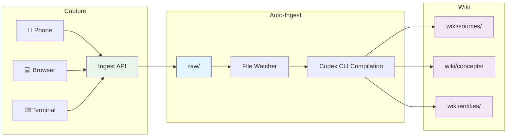

# labs-wiki

# labs-wiki

A personal LLM-powered knowledge wiki based on [Karpathy's LLM Wiki](https://gist.github.com/karpathy/442a6bf555914893e9891c11519de94f) pattern, enhanced with best-of-breed features from top community implementations.

## How It Works



**Sources** are captured from any device via the Ingest API → written to `raw/` → **automatically processed** by the auto-ingest service through Codex CLI → wiki pages created with cross-references. Twitter/X and GitHub repo URLs get specialized deterministic fetch/extraction before compilation. **AGENTS.md** defines the schema that all AI tools follow.

## Architecture

```
labs-wiki/
├── raw/                    # Layer 1: Source documents + durable URL snapshots
│   └── assets/             # Binary files (images, PDFs)
├── wiki/                   # Layer 2: LLM-compiled knowledge
│   ├── sources/            # Source summaries (1:1 with raw/)
│   ├── concepts/           # Concept deep-dives
│   ├── entities/           # Named entities (tools, people, orgs)
│   ├── synthesis/          # Cross-cutting analysis
│   ├── index.md            # Auto-generated topic-clustered catalog
│   └── log.md              # Structured audit log
├── templates/              # Page templates with frontmatter
├── scripts/                # Python utilities (scaffold, lint, index, auto-ingest)
├── wiki-ingest-api/        # FastAPI capture service
├── Dockerfile.auto-ingest  # Auto-ingest watcher service
├─
