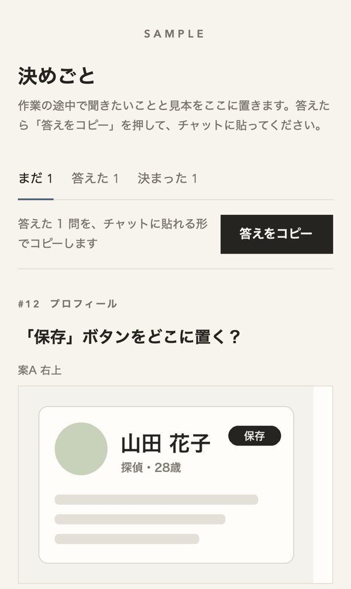
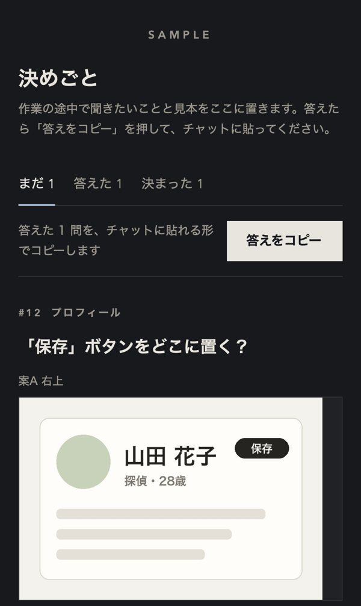

# decision-board（決めごとページ）

Claude が作業中に確認したいことやサンプル画像を、チャットではなく 1 つのページにまとめる Claude Code スキルです。ページで選択肢を選んで「回答」を押し、「回答をコピー」でコピーした文章をチャットに貼り付けると、それが回答として Claude に伝わります。

 

- 質問は 1 行の見出しと選択肢で表示され、サンプル画像は横に並べて比較できます
- 「未回答」「回答済み」「決定済み」のタブに分かれていて、過去に決めたことも見返せます
- 回答はチャットに貼り付けた文章として届くので、マージなどの操作もチャットの指示として進められます
- 「メモ」タブに、Claude が停止している間にやりたいことを文章とスクリーンショットで書いておけます。Claude は次のセッションの開始時にメモを読み、対応すると「確認済み」と対応内容が表示されます

ページは claude.ai のアーティファクト（最初は本人だけが閲覧できます）で、回答はページのデータベース（`db`）にも保存されます。

## インストール

```sh
git clone https://github.com/kaigemap/claude-skill-decision-board.git ~/.claude/skills/decision-board
```

Claude Code に「決めごとページで聞いて」と頼むと使われます。選択肢のある質問や、サンプルを見比べて選んでもらう場面でも、Claude が自動で使います。

## 注意

- アーティファクトと、その実行時の機能（`db`、スクリーンショット用の `assets`）が使える環境が必要です
- 仕事で使う場合は、ページに書く内容を claude.ai に保存してよいか、事前に確認してください

## English

A Claude Code skill that keeps Claude's questions and sample images on one artifact page instead of in the chat log. Pick an option, press 回答 (answer), then 回答をコピー (copy answers) and paste the text into the chat; Claude treats the pasted text as your answer. The メモ (memo) tab takes notes and screenshots while Claude is away; Claude reads them at the start of the next session and marks each as handled. Install with `git clone https://github.com/kaigemap/claude-skill-decision-board.git ~/.claude/skills/decision-board`. The page and the skill text are in Japanese.

## License

MIT
