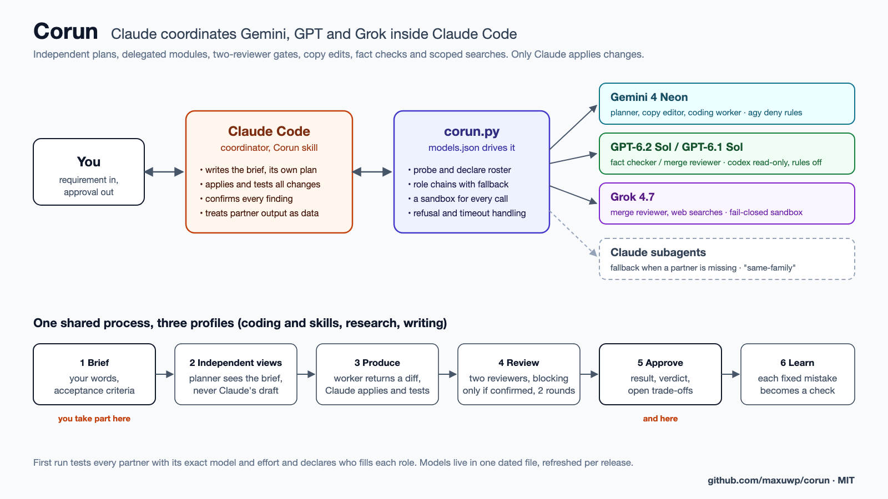

# Corun

A Claude Code skill that lets Claude coordinate work with partner AIs from other vendors. The name sounds like "quorum": a decision passes when independent voices agree.



Claude stays the coordinator. Gemini, GPT and Grok contribute independent plans, self-contained modules, two-reviewer merge gates, copy edits, fact checks and scoped web searches. It works with any subset of these partners and falls back to Claude subagents for missing ones.

## Requirements

- Claude Code.
- Python 3.9 or later (standard library only).
- Any of these command-line tools, signed in with your own subscription:
  - `agy` (Google Antigravity CLI) for Gemini
  - `codex` (OpenAI Codex CLI) for GPT; the copy bundled in the ChatGPT desktop app on macOS is found automatically
  - `grok` (xAI Grok CLI) for Grok

## Install

Copy or clone this folder to `~/.claude/skills/corun/`. Then, in Claude Code, ask for the roster ("corun status"). The first run probes each partner with its exact model and effort and shows which partner fills each role.

## Configuration

- `models.json` defines the partners, models, effort levels, roles and fallback order. To override these settings without modifying the skill, copy `models.json` to `~/.config/corun/models.json` and edit the copy.
- Set `CORUN_CODEX_BIN`, `CORUN_AGY_BIN` or `CORUN_GROK_BIN` to the path of a tool that is not on your `PATH`.
- Local state (the probed partner roster) is stored in `~/.config/corun/roster.json`, and call records are kept for seven days in `~/.cache/corun/runs/`; both stay outside this repository.

## Safety

Claude applies every change to your files; partners return text. Each partner call runs in a fresh private temp folder, which is its working folder and the only place it may write, and is deleted afterwards. The project is never the partner's working folder, so agent config inside the project (`AGENTS.md`, `.codex/`, `.agents/`, `.grok/`) is not loaded. Prompts travel by file or stdin, never on the command line, and partners receive a filtered environment: system basics plus their own CLI's sign-in variables.

- **Codex** runs with `-s read-only`, `--ignore-user-config` and `--ignore-rules`, so saved allow rules cannot lift the sandbox.
- **Antigravity** runs with session-only permission rules that deny file writes, shell commands, MCP tools and web requests, and deny reading anything in your home folder except the project; deny rules override any allow rule in your own settings.
- **Grok** gets only its file-reading tools (no shell, no file writes, no web) and runs under a kernel sandbox profile written for each call under a random name: it reads the project and system folders plus Grok's own `~/.grok` state, and writes only its call folder and its session store. A custom profile that cannot be applied stops the run. Cross-session memory, MCP tools and subagents are off. The runner role gets only the web search and fetch tools and no project grant.

Each restriction was tested with a live write attempt; see `reference/evidence.md`. Claude treats partner output as data, not instructions.

Known limits:
- Partners read the project you name and send what they read to their vendor. Codex's read-only sandbox can read any file your user account can read, and Antigravity can read files outside your home folder.
- Hooks and plugins you installed globally for Antigravity (`~/.gemini/config/`) and Grok (`~/.grok/hooks/`) still run; no flag turns them off. Grok is told not to run your Claude Code and Cursor hooks.
- Grok reads its own state in `~/.grok`, including its sign-in file, which it needs to run; it has no tool that could send that anywhere but xAI.
- Antigravity's home-folder deny rules list what exists when the call starts; a file created in your home folder during the call is not covered.
- Proxy variables (`HTTPS_PROXY` and similar) pass to partners so their CLIs can connect.
- Corun trusts the partner CLIs it finds (`CORUN_*_BIN`, then `PATH`, then `cli_locations`); a tampered CLI is outside what these restrictions can stop.
- The Grok profile has been tested on macOS only.

## Before publishing a fork

```bash
python3 scripts/corun.py scan .
```

The scan reads the files git would publish (git-ignored files are listed as skipped) and the text inside images, and fails on home-directory paths that name a user, your user name, your git email, email addresses, common API key and token formats, credential fields, and local state files. It is pattern-based, so read the diff as well.

## Files

- `SKILL.md`: the process Claude follows.
- `reference/profiles.md`: coding, research and writing profiles.
- `reference/grok-tasks.md`: how to write tasks for the runner role.
- `reference/refresh.md`: updating models after a release.
- `reference/evidence.md`: the dated evidence behind the current role assignment.
- `scripts/corun.py`: partner calls, roster, declaration. `scripts/scan.py`: privacy scan.
- `docs/CUSTOMIZE.md`: changing models, efforts, roles and the process.
- `BACKLOG.md`: planned work.

## Licence

MIT. See `LICENSE`.
