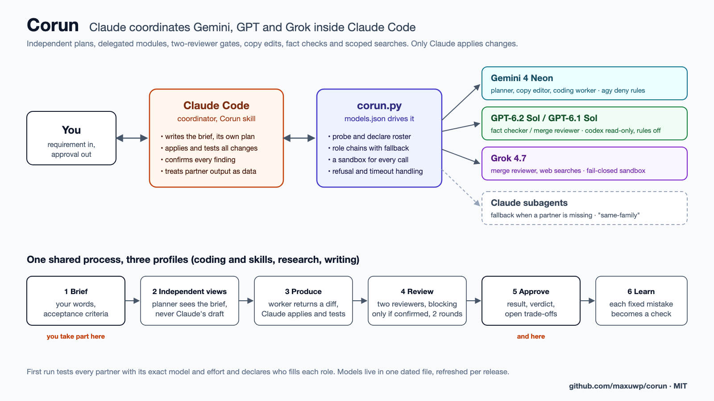

# Customizing Corun



Everything that decides who does what lives in one file, `models.json`. Copy it to `~/.config/corun/models.json` and edit the copy; Corun reads that copy in place of the bundled file, and your changes survive updates of the skill. After any edit, run:

```bash
python3 ~/.claude/skills/corun/scripts/corun.py check
```

`check` probes every partner with its new settings and prints the role table. Corun also notices an edited `models.json` on its own and re-checks at the next call.

## 1. Change a model or its effort

Each partner names its command-line tool, model and reasoning effort:

```json
"sol62": { "label": "GPT-6.2 Sol", "vendor": "OpenAI", "cli": "codex",
           "model": "gpt-6.2-sol", "effort": "high" }
```

- `effort` is passed to the tool as is (`low`, `medium`, `high`, `xhigh`, where the vendor offers them). Higher effort costs more of your subscription.
- For Gemini, the effort is part of the model name (`gemini-4-neon-high`); list the choices with `agy models`.
- For Grok, list models with `grok models`; for Codex, the models your account offers appear in the Codex app.

## 2. Add a partner

A partner is any model reachable through one of the three supported tools (`codex`, `agy`, `grok`). For example, a stronger OpenAI model for hard reviews:

```json
"astra": { "label": "GPT-6.2 Astra", "vendor": "OpenAI", "cli": "codex",
           "model": "gpt-6.2-astra", "effort": "high" }
```

Then place `"astra"` in a role chain (next section). A different tool (for example a local model server) needs a few lines in `build_command()` in `scripts/corun.py`; local models are on the backlog.

## 3. Change who fills a role

Each role has a fallback chain and a number of partners to pick:

```json
"reviewer": { "purpose": "review gate on the final diff or document",
              "pick": 2, "chain": ["grok", "sol61", "neon", "claude-opus"] }
```

- Corun uses the first healthy partners in the chain, in order.
- End every chain with a Claude fallback (`claude-opus`, `claude-sonnet` or `claude-haiku`) so the role always has someone.
- To stop using a partner, remove it from the chains, or leave it out of `partners`.
- `pick` sets how many partners the declaration lists for the role. Each `ask` call returns one partner's answer, so Claude makes one call per partner, adding `--exclude` for those already used; reviewers use two.
- `"web": true` gives a role web search and no project grant (Grok then gets only its web tools); the bundled `models.json` sets it for the runner only. Codex in a web role can still read the disk, so keep web roles on Grok.

The roles are `planner` (independent plan, copy edit), `worker` (self-contained code), `reviewer` (review gate), `checker` (fact and consistency check) and `runner` (narrow searches). Renaming roles also requires editing `SKILL.md`, which tells Claude when to call each role.

## 4. Point Corun to a tool outside your PATH

```bash
export CORUN_CODEX_BIN=/path/to/codex
export CORUN_AGY_BIN=/path/to/agy
export CORUN_GROK_BIN=/path/to/grok
```

The copy of Codex inside the ChatGPT desktop app on macOS is found without this.

## 5. Change the process

- `reference/profiles.md` defines the coding, research and writing profiles: which role does each step, how many reviewers read the result, and what counts as passing. Edit it to add a profile, for example grant proposals with a panel-reviewer read.
- `reference/grok-tasks.md` is the template for runner tasks: one action, explicit scope, fixed output format, length cap.
- `SKILL.md` holds the shared process, the two-tier review rule (blocking findings only after Claude confirms them) and the two-round review limit.

## 6. Refresh after a model release

Follow `reference/refresh.md`: gather model cards and benchmarks with the runner, verify the primary sources, record them in `reference/evidence.md` with a URL per figure, update `models.json` and its `updated` date, then run `check`.

## 7. Keep your copy private before publishing a fork

```bash
python3 ~/.claude/skills/corun/scripts/corun.py scan ~/.claude/skills/corun
```

The scan reads the files git would publish and the text inside images, and fails on home-directory paths that name a user, your user name, your git email, email addresses, common API key and token formats, credential fields and local state files. It is pattern-based, so read the diff as well. Run the tests as well:

```bash
cd ~/.claude/skills/corun && python3 -m unittest discover -s tests
```
