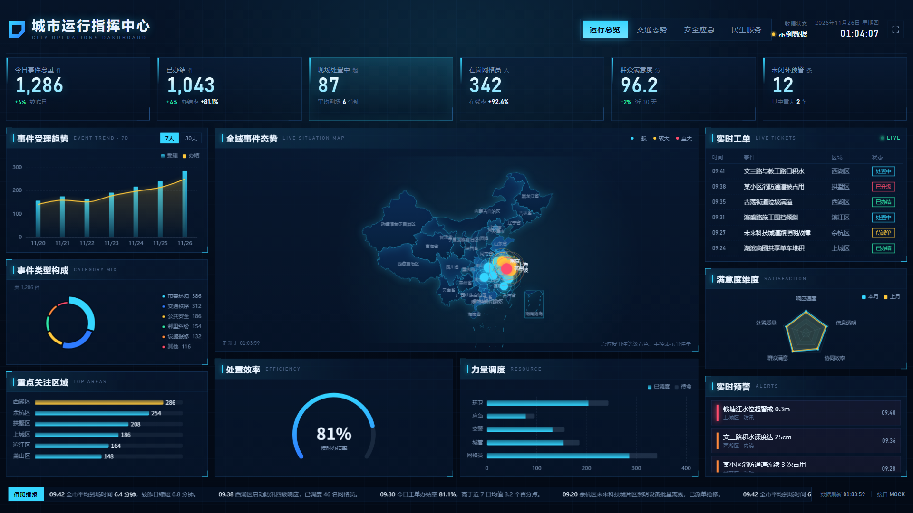

# Data Screen Skill · 数据大屏构建技能

把 **25 套真实开源大屏模板** 整理成知识库，再封装成一个**任何 AI Agent 都能用**的数据大屏开发技能：
它会把你的对话提炼成需求，选一套最合适的布局，生成/改造出可运行的大屏，并预留标准的外部数据接口。



> 上图是 `starter/` 直接用浏览器打开的效果（1920×1080，示例数据）。

## 它解决什么问题

| 你直接让 AI 做 | 用这个 skill |
|---|---|
| 生成一个「科技感大屏」，结果像 SaaS 落地页 | 从 25 套真实大屏里选布局，A1–A6 六种原型 |
| 数字写死在 HTML 里，接接口要重写 | 统一数据契约 + adapter，换数据不改图表 |
| 颜色花、字太小、投屏看不清 | 视觉基线 + 40 项交付检查 |
| 不知道 4K/LED/竖屏怎么适配 | 等比缩放方案 + 特殊比例策略 |
| 改一套老模板，越改越乱 | 模板拆解 + 锚点式改造流程 |

## 快速开始

```bash
git clone https://github.com/jxy162/data-screen-skill.git
cd data-screen-skill

# 1) 生成一个新大屏
node scripts/new-screen.mjs --out screens/city-ops --title "XX市城市运行指挥中心" --theme cyan

# 2) 本地预览（不要双击 index.html，fetch 会被 CORS 拦截）
node scripts/serve.mjs screens/city-ops

# 3) 交付前体检
node scripts/qa.mjs screens/city-ops
```

零依赖，只需要 Node 18+。也可以直接把 `starter/` 复制到任意静态服务器。

## 能力

- **从对话提炼需求**：8 个维度 → `SCREEN_BRIEF.md`，先假设后确认，最多问 3 个问题
- **模板选型**：25 套模板 × 12 个行业 × 6 种布局原型
- **定向改造**：整目录复制 → 文案 → 数据 → 配色 → 模块 → 布局，每步可回退
- **外部数据接入**：REST / SSE / WebSocket / 本地 JSON / 内联 / iframe postMessage
- **统一数据契约**：`meta / kpis / series / lists / geo / alerts / ticker / views` + JSON Schema
- **容错**：超时、重试、指数退避、上一帧保留、状态灯、离线缓存
- **投屏级质量**：1920×1080 等比缩放、4K、超宽、竖屏；40 项交付检查
- **跨 harness**：纯 Markdown + 原生 JS，无框架、无构建工具、无专有 API

## 目录

```
├─ SKILL.md                    # 所有 Agent 的入口（先读这个）
├─ AGENTS.md                   # Codex / 通用 Agent 入口
├─ knowledge/
│  ├─ index.md                 # 选型决策树 + 文件地图
│  ├─ catalog.json             # 25 套模板的机器可读目录
│  ├─ templates/               # 12 篇模板拆解
│  ├─ patterns/                # 布局 / 视觉 / 图表 / 动效 / 质量线
│  ├─ data/                    # 数据契约 / 适配指南 / JSON Schema
│  └─ workflow/                # 需求提炼 / 模板改造 / 交付
├─ starter/                    # 可运行基线（现代 JS + ECharts 5）
├─ scripts/                    # new-screen / qa / serve / fetch / bundle
├─ install/                    # 各 harness 安装说明
└─ assets/previews/            # 25 张模板预览图
```

## 安装到不同 Agent

### Claude Code / Claude Agent Skills

```bash
# 用户级
cp -r data-screen-skill ~/.claude/skills/data-screen-builder

# 或项目级
mkdir -p .claude/skills && cp -r data-screen-skill .claude/skills/data-screen-builder
```
重启会话，输入「用 data-screen-builder 做一个 XX 大屏」。

### Codex / Codex CLI

```bash
cp -r data-screen-skill ~/.codex/skills/data-screen-builder
```
或在项目里放 `AGENTS.md`（本仓库已提供）。

### Cursor / Cline / Roo / Windsurf

把 `SKILL.md` 的内容放进项目规则文件（如 `.cursor/rules/data-screen.mdc`），
或直接引用本目录：`@SKILL.md`。详见 `install/`。

### 只能聊天（ChatGPT / Claude 网页版）

```bash
node scripts/bundle.mjs --preset chat
# → dist/screen-skill.chat.md（约 140KB），整个贴进对话
```

### 任何原生 Agent

只需要两种能力：**读文件** + **写文件**。没有 shell 就手动复制 `starter/`；
没有浏览器就用 `qa.mjs` 静态检查。详见 `SKILL.md` 第 10 节。

## 使用方式

对 Agent 说：

> 用 data-screen-builder 做一个「XX 区防汛指挥大屏」，1920×1080，深蓝科技风，
> 要有降雨、河道水位、泵站、告警、物资 5 个模块，数据先 mock，预留 REST 接口。

Agent 会：

1. 提炼 brief（目标/行业/指标/模块/数据/视觉/约束/假设）
2. 选模板（如 `general-blue` / A1）并说明理由
3. 给出信息架构表（模块 → 图表 → 数据路径）
4. 生成 `screens/xx-flood/`
5. 写 `data/mock.json` + 数据映射
6. 跑 `qa.mjs`，列出验收结果
7. 交付启动说明

## 模板知识库（25 套 / 12 类）

| 家族 | 模板 | 布局 | 最适合 |
|---|---|---|---|
| [深蓝展板](knowledge/templates/01-general-blue.md) | 通用展板、生意参谋 | A1 | 通用汇报、零售 |
| [物流网络](knowledge/templates/02-logistics.md) | 智慧物流、物流平台 | A2 | 物流、供应链 |
| [交通文旅](knowledge/templates/03-traffic.md) | 高速、旅游、视频监控 | A2/A3 | 交通、景区、安防 |
| [政务四型](knowledge/templates/04-gov.md) | 税务、社区、数据中台、舆情 | A4/A5 | 政务 |
| [医疗健康](knowledge/templates/05-medical.md) | 大数据医疗 | A2 | 医院、卫健 |
| [终端风](knowledge/templates/06-weather-terminal.md) | 气象、运维总览 | A6 | 气象、工业、展厅 |
| [金融风控](knowledge/templates/07-finance.md) | 银行信用风险 | A4 | 银行、评级 |
| [电商运营](knowledge/templates/08-ecommerce.md) | 电商公共服务、运营 | A1/A4 | 电商、增长 |
| [车联网/IoT](knowledge/templates/09-iot-vehicle.md) | 车联网、物联网 | A3/A4 | 车辆、设备 |
| [运维/统计/设备](knowledge/templates/10-ops-device.md) | 百度地图、统计、设备 | A3/A4 | 运维、监测 |
| [门店营业厅](knowledge/templates/11-store.md) | 厅店效能 | A4 | 连锁、营业厅 |
| [工地/3D](knowledge/templates/12-construction-land.md) | 智慧工地、土地 3D | A4/A3 | 工地、国土 |

每篇包含：结构拆解、配色表、模块→图表映射、改造锚点、坑位、复用建议。

## 数据接口（核心设计）

页面只消费一个快照，图表不直接请求网络：

```js
window.DASHBOARD_CONFIG = {
  mode: "rest",                    // mock | rest | sse | ws | inline | postMessage
  endpoint: "/api/screen/city-ops",
  pollInterval: 30000,
  timeout: 8000,
  retry: 3,
  transform: "myMapper"            // 可选：字段映射
};
```

最小 payload：

```json
{
  "meta": { "updatedAt": "2026-11-26T09:42:18+08:00", "source": "rest" },
  "kpis": { "total": { "label": "事件总量", "value": 1286, "unit": "件" } },
  "series": {
    "trend": {
      "categories": ["一", "二", "三"],
      "series": [{ "name": "数量", "type": "bar", "data": [1, 2, 3] }]
    }
  }
}
```

完整契约见 [data-contract.md](knowledge/data/data-contract.md) 与 [schema.json](knowledge/data/schema.json)。

## 设计原则

1. **可读性 > 信息量**：3 米外看不清的数字等于没做。
2. **数据与视图分离**：图表只读 `DashboardData`。
3. **先结构后像素**：先定 KPI/模块/图表，再调颜色。
4. **失败不白屏**：保留上一帧 + 状态灯。
5. **示例数据必须可识别**：页面显示「示例数据」。
6. **一个面板只讲一件事**。

## 脚本

| 命令 | 作用 |
|---|---|
| `node scripts/new-screen.mjs --out screens/x --title "..."` | 从 starter 生成新工程 |
| `node scripts/serve.mjs screens/x` | 本地预览（零依赖静态服务器） |
| `node scripts/qa.mjs screens/x` | 静态体检（重复 id / 占位文案 / 资源 / 绑定路径） |
| `node scripts/fetch-templates.mjs` | 克隆上游 25 套模板到 `vendor/` |
| `node scripts/build-catalog.mjs` | 重新生成 `knowledge/catalog.json` |
| `node scripts/bundle.mjs --preset chat` | 打包成单文件 prompt |

## 上游与许可

- 模板来源：[DaShuJuZhiDaPingZhanShi](https://gitee.com/lvyeyou/DaShuJuZhiDaPingZhanShi)，作者 Lang，MIT License。
- 本仓库**不包含**上游源码副本，只包含结构化知识、预览缩略图与重写的 starter。
- 地图 GeoJSON 来自 [DataV.GeoAtlas](https://datav.aliyun.com/portal/school/atlas/area_selector)，仅用于示例。
- Rajdhani 字体：SIL Open Font License 1.1。
- 本仓库代码：MIT。详见 [NOTICE.md](NOTICE.md)。

## Roadmap

- [ ] 更多图表配方（桑基、日历热力、词云）
- [ ] Vue 3 / React 适配层
- [ ] 主题生成器（品牌色 → 完整 token）
- [ ] 大屏截图自动化（Playwright）
- [ ] 英文文档完整版

---

如果这个 skill 帮你省了时间，欢迎 star ⭐；也欢迎提交新的模板拆解或图表配方。
