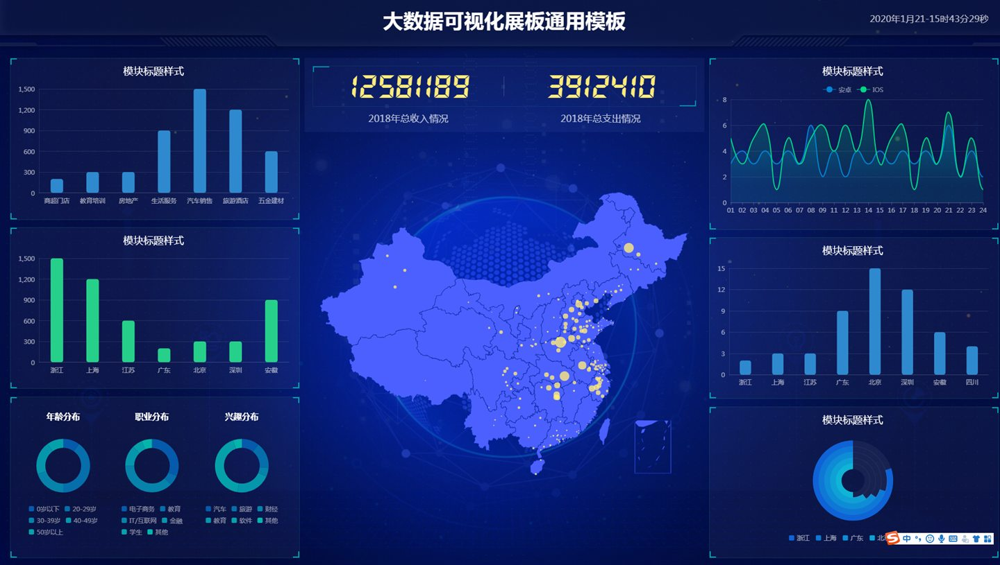
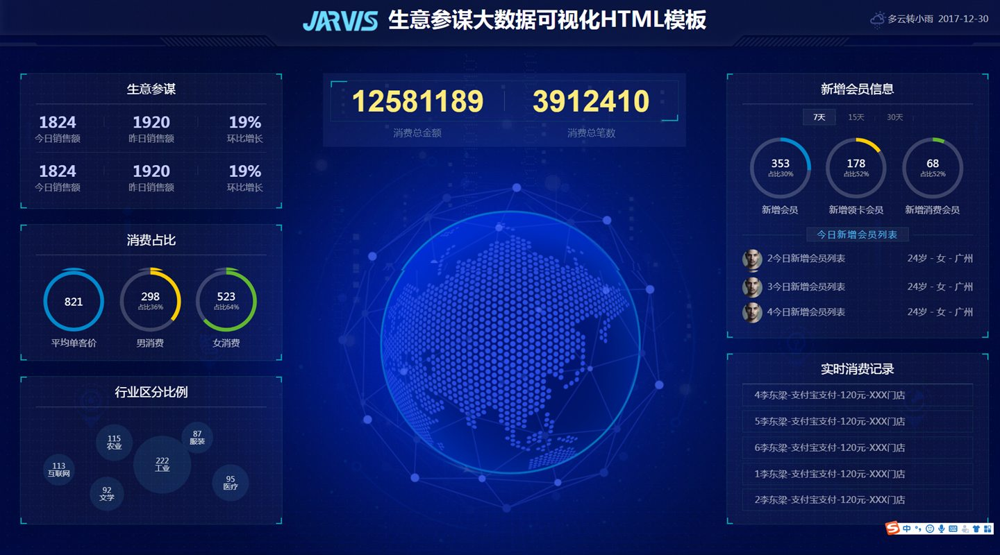

# 01 · 深蓝展板家族（A1 三栏中心地图）

> 覆盖：`general-blue`（大数据可视化展板通用模板）、`retail`（生意参谋销售模板）
> 预览：
> 
> 

## 1. 一眼判断

| | |
|---|---|
| **最适合** | 通用汇报、城市/区域总览、第一次做数据大屏、需要快速改造成任何行业 |
| **不适合** | 信息密度极高的指挥中心（用 03 交通家族）、需要 3D 或视频墙 |
| **难度** | ★☆☆（结构最简单，最适合作为改造起点） |
| **技术栈** | jQuery 1.x + ECharts 4.0.3 + `china.js` + DS-DIGIT 数字字体 |

这两套是同一骨架：**顶部标题 + 30/40/30 三栏 + 中心中国地图 + 左右面板**。
`retail` 只是在中间多了一层 KPI 双行数字和滚动列表，理解一套即可。

## 2. 结构（实际尺寸）

```
.stage 1920×1080
├─ .head            高 1.05rem（≈100px）标题 + 右上时钟
└─ .mainbox
   └─ ul > li ×3    width 30% / 40% / 30%，左右 padding 0 .1rem
      ├─ li1（左）  .boxall ×3：柱图 / 柱图 / 三个环形占比
      ├─ li2（中）  .bar 双 KPI → .map 地图（高 7.2rem）
      └─ li3（右）  .boxall ×3：折线 / 柱图 / 环形
```

关键 CSS（`css/comon0.css`）：

```css
html{ font-size: 100px }               /* JS 里改成 windowWidth/20 */
.mainbox>ul>li{ float:left; width:30%; }
.mainbox>ul>li:nth-child(2){ width:40%; }
.boxall{ background:rgba(255,255,255,.04) url(../images/line.png); border:1px solid rgba(25,186,139,.17); }
.boxall:before,.boxall:after{ width:.1rem; height:.1rem; border-top:2px solid #02a6b5; }
```

## 3. 配色

| 角色 | 值 | 用途 |
|---|---|---|
| 背景 | `#000d4a` + `images/bg.jpg` | 深蓝星空 |
| 结构线 | `rgba(25,186,139,.17)` / `#02a6b5` | 面板边框、四角 |
| 主蓝 | `#399bff` | 柱图、链接 |
| 青 | `#49bcf7` | 副标题、折线 |
| 黄 | `#ffeb7b` | KPI 数字（DS-DIGIT） |
| 文字 | `#fff` / `rgba(255,255,255,.7)` | 标题 / 说明 |

`retail` 与之一致，仅多了 `#ffc000` 的橙色强调。

## 4. 模块 → 图表 → 数据

| 区域 | 内容 | 图表 | starter 对应 |
|---|---|---|---|
| 中上 | 双 KPI（收入/支出） | 数字翻牌 | `.kpi-row` |
| 中心 | 中国地图 | `map` + `effectScatter` | `#chart-map` |
| 左上 | 类别对比 | `bar` | `#chart-rank` |
| 左中 | 区域对比 | `bar` | `#chart-rank` |
| 左下 | 年龄/职业/兴趣占比 | 3×`pie`（环） | `#chart-types` |
| 右上 | 24h 趋势双线 | `line` | `#chart-trend` |
| 右中 | 区域柱图 | `bar` | `#chart-resource` |
| 右下 | 环形占比 | `pie` | `#chart-types` |

`retail` 额外：新增会员滚动列表、实时消费流水、行业区分比例、消费占比环图。

## 5. 改造锚点

| 要改 | 位置 |
|---|---|
| 标题 | `<title>` + `.head h1` |
| 时钟 | `.weather #showTime` + `<script>` 里的 `time()` |
| 面板标题 | `.alltitle`（当前是「模块标题样式」，必须全换） |
| 面板高度 | 行内 `style="height: 3.2rem"`（6 处） |
| 配色 | `css/comon0.css` 中 `#02a6b5` / `#399bff` / `#000d4a` |
| 数据 | `js/area_echarts.js`、`js/js.js`、`js/china.js` |
| 地图 | `js/china.js` 的 `echarts.registerMap('china', ...)` |
| 滚动列表 | `retail` 的 `$(document).ready` 里 `setInterval` + `animate({marginTop})` |

## 6. 定向改造步骤（R 模式）

1. 复制整个目录 → `screens/my-board`。
2. 先跑基线，截图确认地图/图表正常。
3. 全局替换标题与 6 个 `.alltitle`。
4. 改 `js/area_echarts.js` 里的 `data` 数组（保持 `xAxis.data` 与 `series.data` 长度一致）。
5. 改配色：`#02a6b5` → 品牌色；`#000d4a` → 背景色。
6. 改 `html{font-size}` 的 JS 为 `innerWidth/20`（原模板已是）。
7. 删除多余面板时同步删除对应 `echarts.init`，避免空实例。
8. 用 `qa.mjs` + 1920×1080 截图验收。

## 7. 复用建议（M 模式）

- **直接复用**：三栏比例、中心地图 + 左右各 3 面板的节奏、双 KPI 位置。
- **重写**：背景图（改 CSS 渐变 + 网格）、面板切图（改伪元素角标）、DS-DIGIT（改 Rajdhani）。
- **不要复用**：`float` 布局、`rem` 缩放、ECharts 4 的 `itemStyle.normal` 写法。

starter 已是这套骨架的现代版：`grid-template-columns: 420px 1fr 420px`，中心地图 + 6 KPI + 6 图表。

## 8. 坑

- `.boxall` 同时设置 `padding` 和 `height`，`box-sizing:border-box` 下内容区会被压缩 → 图表高度用 `calc(100% - 30px)`。
- 地图容器 `.map4` 用了 `width:200%; left:-50%` 放大，改造时容易超出屏幕。
- `retail` 的滚动用 `animate({marginTop:-'.52'*i+'rem'})`，字符串乘法在部分浏览器会得到 `NaN` → 改数值计算。
- 原模板的 `$(window).load()` 在 jQuery 3 中已移除 → 升 jQuery 时改成 `$(window).on("load")`。
