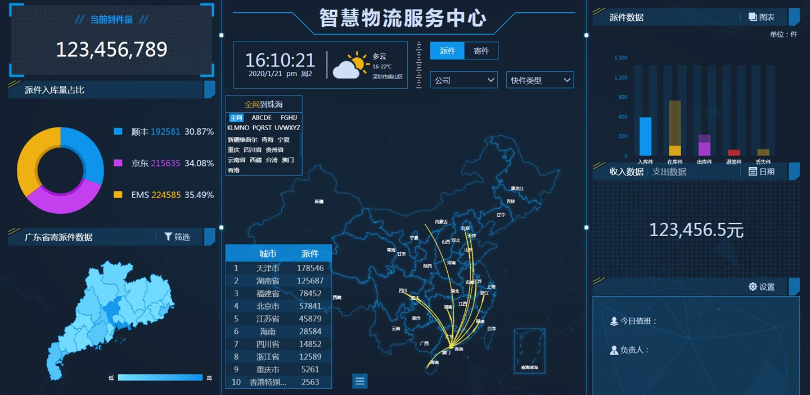
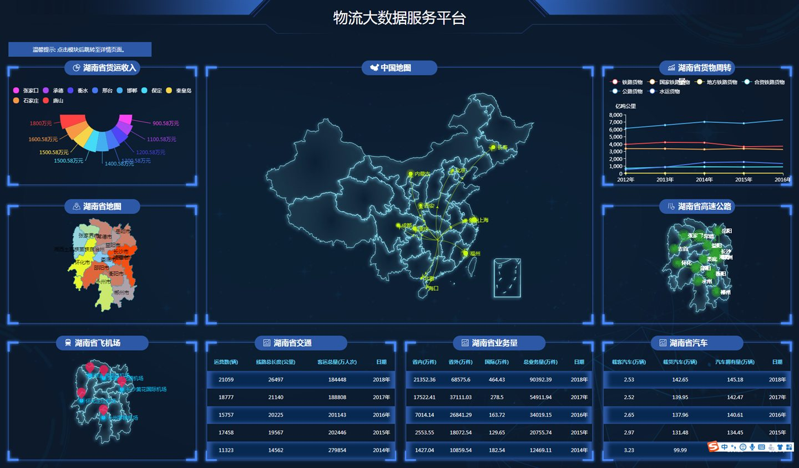

# 02 · 物流网络家族（A2 三栏高密度）

> 覆盖：`logistics`（智慧物流服务中心）、`logistics-2`（物流大数据服务平台）
> 
> 

## 1. 一眼判断

| | |
|---|---|
| **最适合** | 物流/快递/供应链、干线网络、需要「中心全国地图 + 左右指标」的行业 |
| **不适合** | 只需要 4 个指标的低密度汇报（用 01） |
| **难度** | ★★☆ |
| **技术栈** | jQuery 3 + ECharts 4.0.3 + `china.js` + `guangdong.js` + layer |

## 2. 结构

```
.container-flex（flex 三列）
├─ .box-left（24%）
│  ├─ .left-top      当前到件量（超大数字）
│  ├─ .left-center   派件入库占比（环图 + 自定义图例/数值）
│  └─ .left-bottom   广东省寄派件地图（筛选器 + 地图）
├─ .box-center（52%）
│  ├─ .center-top    大标题（切角）
│  ├─ 时钟 + 天气 + 派件/寄件 Tab + 下拉筛选
│  ├─ 全国地图 + 飞线 + 城市 TOP10 表
│  └─ 底部图例/说明
└─ .box-right（24%）
   ├─ 派件数据（柱图 + 单位）
   ├─ 收入数据（大数字 + Tab）
   └─ 今日值班（人员）
```

**信息密度**：约 10 个信息块，高于 01、低于 03。
**视觉特征**：六边形暗纹、斜切角面板、细描边、青蓝主色 + 黄/品红点缀。

## 3. 配色

| 角色 | 值 |
|---|---|
| 背景 | `#071a33` + 六边形纹理图 |
| 面板 | `rgba(9,40,70,.55)` + `1px solid rgba(0,194,255,.35)` |
| 主色 | `#0e94ea` / `#00c2ff` |
| 文本 | `#cdddf7` / `#fff` |
| 强调 | `#ffc000`（流向/选中）、`#ff3dbe`（第三方对比） |
| 正向 | `#009f95` |

## 4. 模块 → 图表

| 模块 | 图表/组件 | 数据 |
|---|---|---|
| 当前到件量 | 大数字 | `kpis.parcels.value` |
| 派件入库占比 | `pie` 环 + 右侧数值列表 | `series.types` |
| 广东省地图 | `map`（guangdong）+ 热力 | `geo.province` |
| 全国流向 | `map` + `lines` + `effectScatter` | `geo.points/lines` |
| 城市派件 TOP10 | 表格（滚动） | `lists.cities` |
| 派件数据 | `bar`（5 类，带单位） | `series.categories` |
| 收入 | 大数字 + Tab | `kpis.revenue` |
| 今日值班 | 文本列表 | `lists.duty` |

## 5. 改造锚点

| 要改 | 位置 |
|---|---|
| 标题 | `.center-top h1`、`<title>` |
| 数字 | `.current-num p`、`.box-right` 的大数字 |
| 筛选器 | `.select`、`.select-ul`、`#filCon` 的 `data-type` |
| 地图 | `js/data/guangdong.js`、`js/base.js` 里的 `echarts.init` |
| 配色 | `css/style.css` 中 `#0e94ea`、`#00c2ff`、`#ffc000` |
| 缩放 | `js/rem.js` + `<body style="visibility:hidden">` 的入场 |

## 6. 改造步骤

1. **先处理入场**：`body{visibility:hidden}` 由 JS 在加载后显示；如果 JS 报错，整页空白。改为 CSS 默认可见 + `opacity` 过渡。
2. **替换筛选器选项**：`.select-ul li` 的 `data-value` 要与后端枚举一致。
3. **地图**：默认是广东省；换省份需替换 `guangdong.js` 的 GeoJSON 并改 `registerMap` 名称。
4. **流向**：`lines` 的 `coords` 是经纬度数组，`effect` 控制飞线速度。
5. **数字单位**：件/万元要在标题或单位标签写清。
6. **切角**：面板切角多为背景图；换色用 `mask-image` 或重画 `clip-path`。

## 7. 复用建议

- **最值得复用**：中心标题的切角造型、左侧「大数字 + 环图」组合、全国流向地图的图层顺序（地图 → 飞线 → 涟漪点）。
- **可替换**：六边形纹理（改 CSS 点阵）、下拉筛选（改原生 `<select>` 或自定义）、值班模块（改告警列表）。
- **注意**：`logistics` 的 DOM 结构非常适合 A2，但 CSS 与切图耦合重；M 模式重建更快。

## 8. 坑

- `body{visibility:hidden}` + 外部字体/地图加载失败 → 永远白屏。必须加超时兜底。
- `layer` 弹窗与全屏缩放冲突：`transform:scale` 的父级会导致弹窗定位偏移。
- 地图省份名用简称（「广东」）还是全称（「广东省」）要与 GeoJSON 一致。
- 左侧环图的图例是手写 DOM，不是 ECharts legend；改数据时两处都要改。
