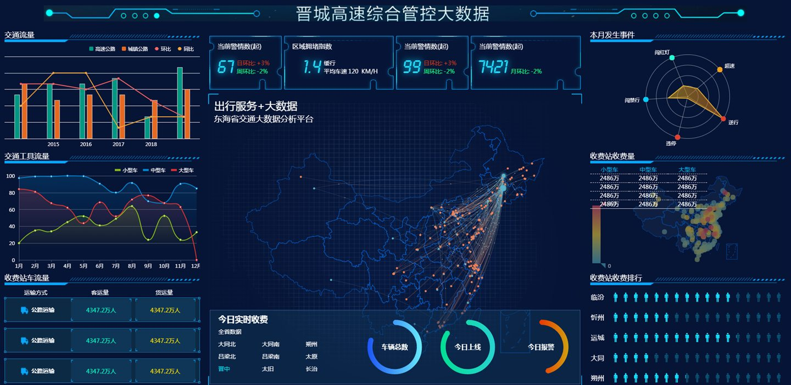
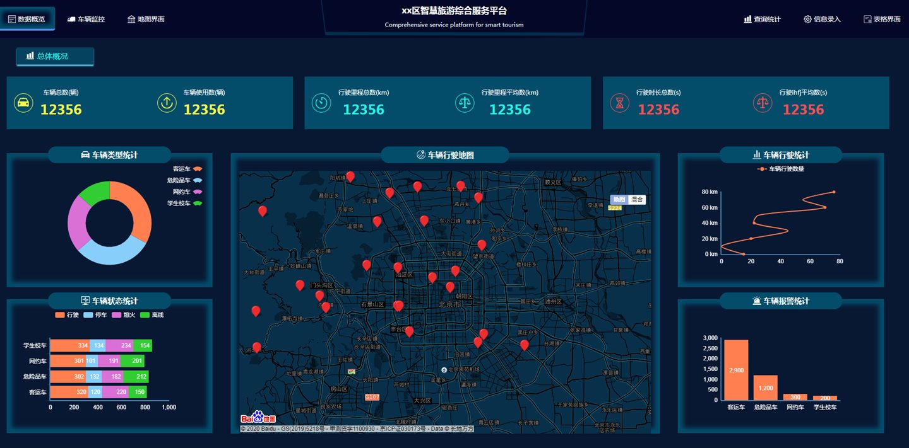
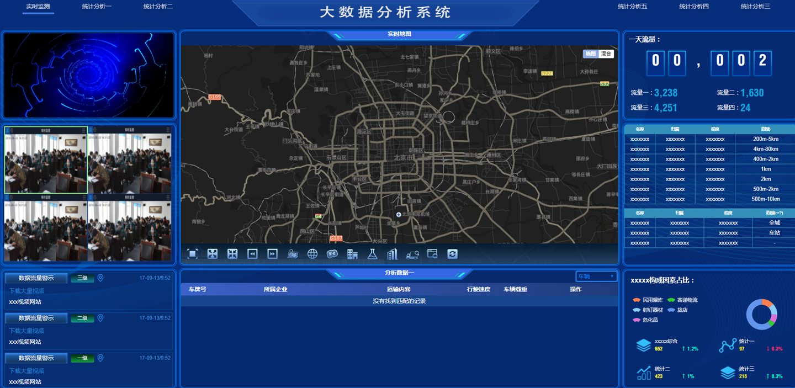

# 03 · 交通 / 文旅 / 视频监控家族（A2–A3）

> 覆盖：`highway`（高速交通）、`tourism`（智慧旅游，多页）、`traffic-video`（视频监控）
> 
> 
> 

## 1. 一眼判断

| 模板 | 最适合 | 难度 | 技术栈 |
|---|---|---|---|
| highway | 交通/高速/交警指挥中心，指标极多 | ★★★ | jQuery + ECharts 4 + `china.js` |
| tourism | 文旅/景区，多页面钻取 | ★★☆ | jQuery + ECharts 2.2.7 + bootstrap |
| traffic-video | 视频监控/安防/卡口 | ★★★ | jQuery + ECharts 2.2.7 + zTree + artDialog |

## 2. highway：信息密度天花板

### 结构

```
三栏（左 26% / 中 48% / 右 26%），顶部电路感标题条
左：交通流量（柱+线）→ 交通工具流量（多线）→ 收费站车流量（KPI 列表）
中：4 枚警情 KPI → 中心飞线地图 → 底部「今日实时收费」三环
右：本月事件雷达 → 收费站收费排行（表格 + 人形图标）→ 收费站收费柱
```

### 配色

| 角色 | 值 |
|---|---|
| 背景 | `#061537` + 网格 |
| 主色 | `#007aff` / `#55bfff` |
| 正向 | `#00ffc6` |
| 警示 | `#ff8a3d` |
| 文字 | `#fff` / `#a8c6e8` |

### 模块 → 图表

| 模块 | 图表 |
|---|---|
| 交通流量 | `bar` + `line`（双 Y 轴） |
| 交通工具流量 | 3×`line`（小型/中型/大型） |
| 收费站车流量 | 3 行 KPI 表（客运量/货运量） |
| 4 枚警情 | 大数字 + 环比文字 |
| 中心地图 | `map` + `lines` + `effectScatter` |
| 本月事件 | `radar`（5 维） |
| 收费排行 | 表格 + 人形图标重复 |
| 今日实时收费 | 3×`pie` 环形进度 |

### 改造锚点

- 标题：`.ksh`、`.head_top`
- 面板：`.visual` / `.visual_box` / `.visual_title` / `.visual_chart`
- 人形图标：`.sfzcll_pos_box` / `.sfzcll_box`
- 地图：`js/china.js` + `echarts.init` 的 `geo`
- 缩放：`transform:scale`（查看页面里的 `resize` 逻辑）

### 坑

- 人形图标是 N 个 DOM `<i>`，数据量大时卡顿 → 改用 `pictorialBar` 或 canvas。
- 雷达图 5 维指标名长，必须 `axisName.fontSize ≤ 10` 且留边距。
- 双 Y 轴单位不同（辆/辆）时，第二轴要写明。
- 中心地图的飞线 `effect.trailLength` 过大会糊成一片。

## 3. tourism：多页面结构

### 结构

```
index.html（首页总览）
├─ map.html        景区地图/客流
├─ static.html     统计分析
├─ message.html    留言/舆情
└─ table1.html     数据表格
共用：header（左导航 / 中标题 / 右时间）+ `.con` 内容区
```

### 配色

`#034c6a` 背景、`#337ab7` 主色、`#00d4ff` 强调、`#ffd166` 暖色。
比 highway 更「旅游门户」，青蓝更亮。

### 模块

景区总览 KPI、客流趋势、客源地排行、景区地图、舆情/留言、数据表格、轮播图。

### 改造要点

- 多页面共享状态：用 URL 参数（`?scenic=xxx`）或 `localStorage`。
- 导航 `.nav_active` 要按当前页高亮（每页 HTML 里写死或 JS 判断 `location.pathname`）。
- ECharts 2.2.7 的 `map` 配置与 5 不同，升级时重点改地图与 `itemStyle`。
- 子页返回首页的按钮必须明显，否则演示时容易「迷路」。

## 4. traffic-video：视频墙 + 资源树

### 结构

```
.data_bodey
├─ .index_nav        顶部导航
├─ .l_left           左侧资源树/设备列表（zTree）
├─ 中间视频宫格       1/4/9 画面切换
└─ .r_right          右侧统计（警情、卡口、地图）
```

### 技术栈注意

- **ECharts 2.2.7**（`echarts-all.js`）→ 只建议借鉴布局，图表层重写。
- 视频：浏览器不能直接播 `rtsp://`，需要网关转 `WebRTC` / `HLS` / `FLV`。
- `zTree` + `artDialog` 是老牌 jQuery 插件，维护成本高；新项目用原生树 + `<dialog>`。

### 改造要点

1. 先把视频换成占位图（`` 或 `<video poster>`），保证无流也能演示。
2. 视频宫格用 CSS Grid，`1/4/9` 布局切换只改 `grid-template-columns`。
3. 资源树数据从 `json/` 目录读取，改成接口时保持树结构 `{name, children}`。
4. 地图点位（卡口）用 `effectScatter`，点击弹窗显示过车信息。
5. 性能：同时播放 9 路视频会占满 GPU；默认 4 路，其余用截图轮播。

## 5. 三者共同的改造建议

- **标题条**是视觉重点：电路/切角/双线，改色时优先处理。
- **中心地图**必须有三层：底图着色、点位、流向（至少两层）。
- **KPI 小卡**用「标签 + 大数字 + 环比」三行，不要只放数字。
- **颜色**控制在 1 主色 + 1 正向 + 1 警示；交通类可加 1 个橙色表示拥堵。
- **不要照搬** 2018 年的「人形图标」「金属质感切图」「IE 兼容代码」。

## 6. 推荐落地方案

| 需求 | 方案 |
|---|---|
| 交通指挥中心，指标 10+ | starter + highway 的信息架构（A2） |
| 景区/文旅，需要多页 | starter 单页 + 顶部 Tab 替代多页（更稳） |
| 视频监控 | starter + 视频宫格组件（不自带），ECharts 只做统计侧栏 |
| 只需要 1 张地图 + 4 指标 | 不要用这三个，回到 01 |
