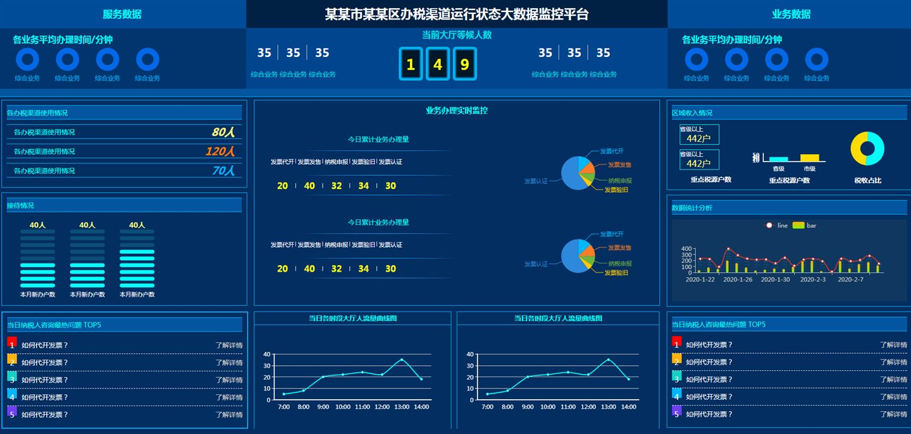
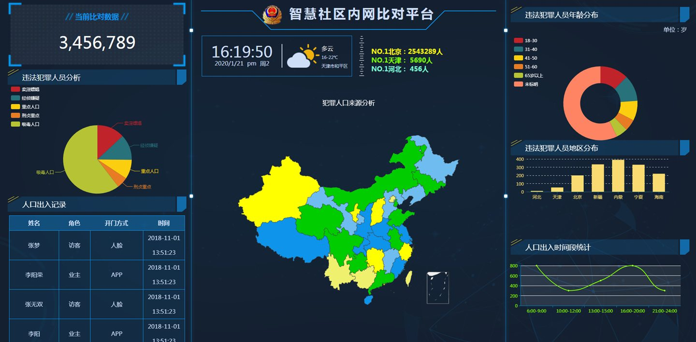
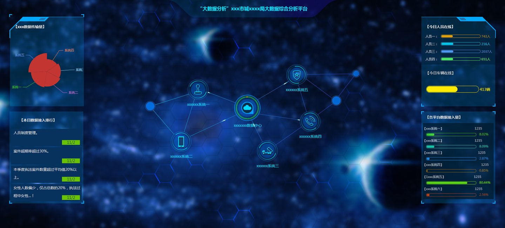
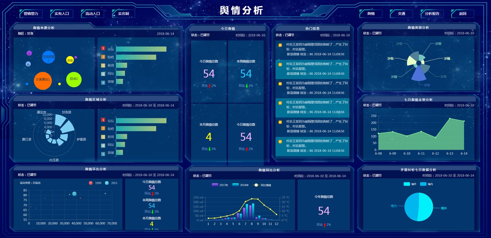

# 04 · 政务四型（税务 / 社区 / 数据中台 / 舆情）

> 覆盖：`tax`、`community`、`gov-neon`、`opinion`
> 
> 
> 
> 

四套都是政务，但视觉与结构差异很大，选错会「不像政府项目」。

## 1. 选型对照

| 模板 | 场景 | 原型 | 关键气质 |
|---|---|---|---|
| tax | 办税大厅、渠道运行 | A4 | 青色霓虹、网格卡片、紧凑 |
| community | 社区/网格/街道 | A4 | 亮蓝、亲和、地图居中 |
| gov-neon | 数据中台、系统架构 | A5 | 黑底 + 电光蓝 + 荧光绿，低密度 |
| opinion | 舆情/网信/宣传 | A4（浅色） | 白底深蓝，信息型，适合亮环境 |

## 2. tax · 工商办税监控

- **结构**：顶部 `headerLeft/Center/Right`；`firstCon` 区左中右三列；左列趋势，中列指标 + 地图，右列排行/占比。
- **配色**：`#042d6b` 深蓝底、`#00b3fe` 主蓝、`#07f7f4` / `#05fef8` 青色霓虹、`#004c98` 结构线。
- **模块**：办税总量、渠道分布、窗口繁忙度、区域对比、实时排队、业务类型占比。
- **改造锚点**：`.firstCon`、`.firstLeftsec`、`.firstcenCen`、`.firstCon-right`、`headerCenter`。
- **坑**：霓虹青只做标题/数字；大面积填充会刺眼。ECharts 4 的 `pictorialBar` 在 5 中参数名有变化（`symbolSize` 支持数组）。

## 3. community · 智慧社区

- **结构**：`.container-flex` 三列；左：人口/房屋/事件 KPI + 表格；中：社区地图 + 网格；右：趋势/占比。
- **配色**：`#071a33` 底、`#0e94ea` 主蓝、`#b1d2ec` 浅蓝文字、`#009f95` 正向。
- **模块**：人口/房屋/事件、网格分布、重点人员、事件趋势、社区地图。
- **改造锚点**：`.box-left`、`.box-center`、`.box-right`、`.title-box`、`.chart-box`、`#map`。
- **坑**：涉及个人信息，演示必须虚构；「重点人员」类模块在正式项目里要脱敏/权限控制。
- **适合改成**：街道/乡镇/园区/校园的「一屏统览」。

## 4. gov-neon · 综合分析平台

- **结构**：`.Hometitlebox` 顶部标题；`.maineffectoutbox` 中心关系图；左右 `.effectposition` 小面板。
- **配色**：`#020a18` 近黑、`#00a8ff` 电光蓝、`#aeff00` 荧光绿、`#00e4ff` 青、`#fd4275` 品红。
- **模块**：中心系统关系网络、数据传输量、今日人员在线、车辆在线、数据接入排行、平台接入量。
- **改造锚点**：`.Hometitlebox`、`.maineffectoutbox`、`.circleeffectclass`、`.acrossremindeffect`。
- **坑**：
  - 关系图 `layout:"force"` 每次刷新会抖动 → 固定坐标或 `layout:"none"`。
  - 荧光绿 `#aeff00` 只做强调，不做正文。
  - 中心留白很大，如果数据不足会显空 → 至少 8 个节点 + 12 条边。
- **最适合**：领导参观、系统架构介绍、汇报型大屏（信息少但要求精致）。

## 5. opinion · 舆情分析（浅色）

- **结构**：`.topbnt_left/right` 顶部导航；`.left1` 左侧列表；中间 `.widget-inline-box` 图表区；多页（activity/analysis/people/public/traffic）。
- **配色**：白底 `#fff`、主蓝 `#337ab7`、正向 `#3c763d`、警示 `#d9534f`、浅黄 `#fcf8e3`。
- **模块**：舆情热度、情感分布、传播路径、关键词云、意见领袖、事件时间线。
- **改造锚点**：`.topbnt`、`.left1`、`.widget-inline-box`、`css/*.css` 里的 bootstrap 变量。
- **坑**：
  - 浅色大屏在 LED 上对比度不足 → 正文用 `#243447`，不要 `#999`。
  - 词云需要额外 `echarts-wordcloud` 插件，且中文分词要在后端做。
  - D3 v3 + ECharts 4 混用，注意全局变量冲突。
- **适合改成**：企业舆情、品牌监测、客服工单分析。

## 6. 政务项目的额外要求

| 要求 | 做法 |
|---|---|
| 数据口径 | 标题/脚注写明「统计时间」「数据来源」「单位」 |
| 等保/内网 | 所有资源本地化；不得引用公网 CDN/地图 |
| 脱敏 | 人名/身份证/手机号/企业名全部虚构或掩码 |
| 术语 | 用政府惯用语（「办结率」「按时办结」「网格事件」） |
| 配色 | 避免娱乐化高饱和；红只用于告警 |
| 字体 | 标题可用黑体/思源黑体，正文系统字体 |

## 7. 改造优先级

1. **gov-neon** 最适合做「汇报型」：改标题 + 换中心图 + 4 个侧栏指标即可。
2. **tax** 最适合做「大厅监控」：模块清晰、改造成本低。
3. **community** 最适合做「街道/园区」：地图 + 网格是核心。
4. **opinion** 只在需要浅色/网页端时选；LED 项目慎用。
