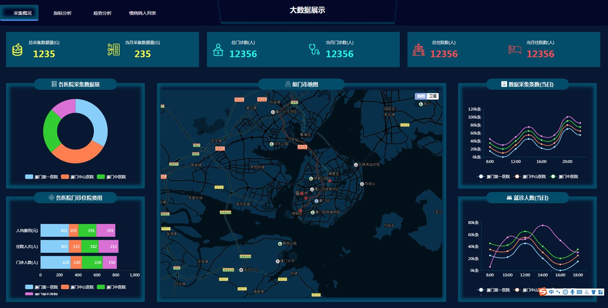

# 05 · 医疗健康（A2 三栏 + 多视图）

> 覆盖：`medical`（大数据医疗服务平台）
> 

## 1. 一眼判断

| | |
|---|---|
| **最适合** | 医院运营、区域卫健、慢病管理、分级诊疗 |
| **不适合** | 需要强 GIS/轨迹的场景（医疗点位通常很少） |
| **难度** | ★★☆ |
| **技术栈** | jQuery + ECharts 4.0.3 + 多视图 HTML（index / chronic / NCDindex / quota / trend） |

## 2. 结构

```
.views/
├─ index.html      总览（三栏）
├─ chronic.html    慢病管理
├─ NCDindex.html   非传染性疾病指标
├─ quota.html      处方/额度
└─ trend.html      趋势分析
```

总览页：`header`（左导航/中标题/右时间）+ `.con` 三栏：
- 左：门诊/住院 KPI、慢病分布、医生/床位
- 中：区域/医院地图 + 转诊流向
- 右：趋势、费用构成、满意度

## 3. 配色

| 角色 | 值 |
|---|---|
| 背景 | `#061b2e` / `#034c6a` |
| 主色 | `#337ab7` / `#5bc0de` |
| 洁净青 | `#7bd7c8` |
| 文字 | `#eaf6ff` / `#9fbdd6` |
| 警示 | `#f0ad4e` / `#d9534f` |

医疗大屏的配色要「干净」，少用高饱和红绿；用青/蓝/浅绿表达健康感。

## 4. 模块 → 图表

| 模块 | 图表 | 数据 |
|---|---|---|
| 门诊/住院量 | `bar` + `line` | `series.visits` |
| 慢病分布 | `pie` / 环 | `series.chronic` |
| 年龄/性别构成 | `bar` 堆叠 / 金字塔 | `series.demography` |
| 转诊流向 | `map` + `lines` | `geo.lines` |
| 费用趋势 | `line` 多系列 | `series.cost` |
| 处方/额度 | `scatter` / 表格 | `lists.quota` |
| 满意度 | `radar` / `gauge` | `series.satisfaction` |

## 5. 改造锚点

| 要改 | 位置 |
|---|---|
| 标题 | 各页 `header .header_center` |
| 导航 | `.nav` / `.nav_active` / `.nav_1..8` |
| 内容区 | `.con` / `.con_div` / `.con_div_text` |
| 图表 | `scripts/` 下的 JS，搜 `echarts.init` |
| 配色 | `css/` 中 `#337ab7`、`#5bc0de`、`#034c6a` |
| 多视图 | 5 个 HTML 的导航链接 |

## 6. 改造要点

1. **先合并为单页**：5 个 HTML 共享 header/样式，维护成本高；用顶部 Tab + 一个容器切换更稳。
2. **统一数据口径**：门诊量按「人次」、住院按「床日」、收入按「万元」，全屏一致。
3. **地图降级**：医院点位少时，用「区域着色 + 医院点位」即可，不需要飞线。
4. **隐私**：患者姓名、病历号、医生姓名全部虚构；真实项目需脱敏 + 权限。
5. **颜色语义**：绿=正常、黄=预警、红=危急值；不要用红表示「增长」。

## 7. 复用建议

- **值得复用**：三栏节奏、慢病环图 + 趋势组合、顶部导航多视图。
- **替换**：ECharts 4 写法、固定 px 布局、bootstrap 表格。
- **M 模式落地**：starter 的 A1 布局 + 医疗主题（青蓝）+ 5 个 Tab 视图，一天可完成。

## 8. 坑

- 多页导航用相对路径，移动目录后 404。
- `chronic/NCD/trend` 等页面各自引一套 CSS，改主题要改 5 处。
- 医疗图表多但每屏只应有一个主视觉（通常是区域地图或门诊趋势）。
- 不要用「人体 3D 模型」做装饰，除非它真的承载部位/科室数据。
