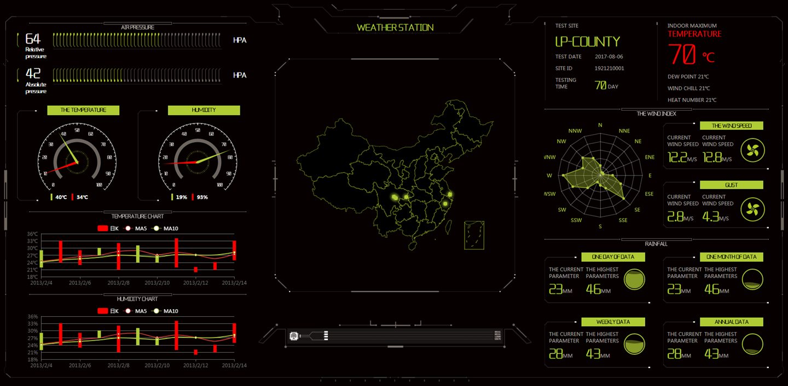
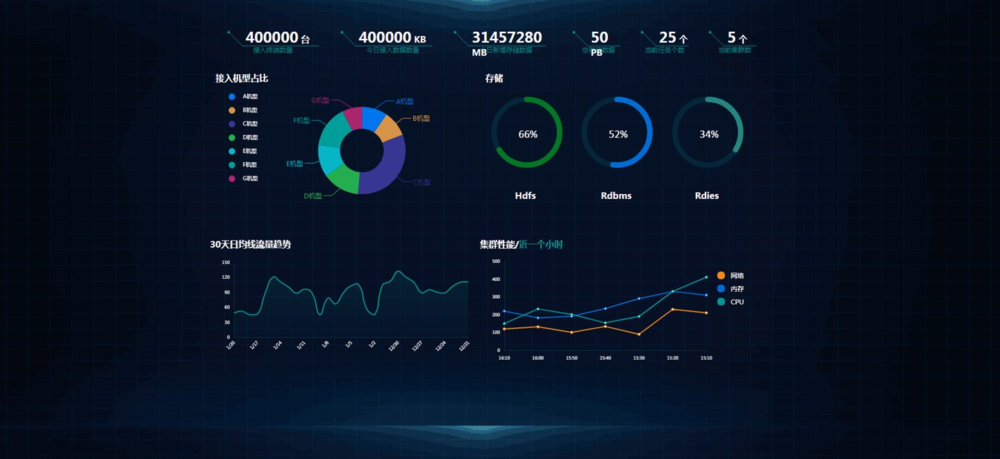

# 06 · 硬边终端风（气象 / 运维总览）

> 覆盖：`weather`（气象预报）、`ops-ring`（TIZA STAR 运维总览）
> 
> 

## 1. 一眼判断

| | |
|---|---|
| **最适合** | 气象/环境/工业监控、想与「深蓝科技风」拉开差距的展厅 |
| **不适合** | 政务汇报（荧光色不够稳重）、需要高信息密度的指挥中心 |
| **难度** | ★★★（weather）/ ★★☆（ops-ring） |
| **技术栈** | jQuery + ECharts 4.9 + ECharts GL 1.0 + Three.js |

## 2. 视觉规则（这套的核心）

| 规则 | 说明 |
|---|---|
| 背景 | 纯黑 `#000`，不加深蓝 |
| 线条 | 1px、无圆角、无渐变、`#b0cc35` 或 `#d8ff3e` |
| 文字 | 全大写英文标签 + 等宽数字；中文很少 |
| 装饰 | 刻度尺、括号、十字准星、扫描线 |
| 颜色 | 荧光黄绿为主，红色只做危险值 |
| 动效 | 指针转动、数值闪烁，幅度小 |

**不要把**这套风格套到政务/金融项目上——会像「实验室仪表」而不是「政府大屏」。

## 3. weather · 气象预报

### 结构

```
.content
├─ 左：气压表 ×2 → 温度/湿度仪表 ×2 → 温度折线 → 湿度折线
├─ 中：中国地图（荧光轮廓 + 点位）→ 底部 3D 地球/时间轴
└─ 右：站点信息 → 风向玫瑰 → 风速 → 降雨 ×4
```

### 配色

`#000` 背景；`#b0cc35` 主荧光；`#f2ff00` 高亮；`#ff2b2b` 危险；`#8a8a8a` 次要。

### 模块 → 图表

| 模块 | 图表 |
|---|---|
| 相对/绝对气压 | `gauge`（刻度盘） |
| 温度/湿度 | `gauge` + 折线 |
| 风向 | `radar`（8 方位）或极坐标 |
| 降雨 | `bar` + `line` |
| 中国地图 | `map`（荧光边界） |
| 3D 地球 | Three.js / ECharts GL `globe` |

### 改造锚点

- 结构：`.content`、`.left`、`.air`、`.tith1`
- 数值：`.numfont` / `.air-val`
- 图表：`js/` 下 `echarts.init`、`three` 初始化
- 配色：`css/` 中 `#b0cc35`、`#f2ff00`

### 坑

- Three.js + ECharts GL 同时加载，包体 > 3MB；内网交付要打包本地。
- 荧光绿在投影仪上偏黄/偏白，交付前用目标设备实测。
- 仪表盘刻度密集，字体小于 9px 会糊。
- 3D 地球在低配机 15fps，必须有 2D 降级。

## 4. ops-ring · 运维总览

### 结构

```
.main
├─ .layer            背景光环
├─ .layer02-data     中心数据
├─ .layer03-panel    左/右图表（环形排列）
└─ .layer04-panel    外围指标
```

### 视觉

深色 + 环形拓扑，中心留白，四周悬浮指标。
比 weather 更「科幻」，但仍是细线 + 单色强调。

### 模块

系统健康度环、节点状态、流量趋势、告警数、拓扑关系。

### 改造要点

- 环形布局靠绝对定位 + `transform: rotate()`，改节点数要重算角度。
- 中心留白必须有内容（健康度/总量），否则整屏空。
- 适合做成「IT 运维/系统健康」的汇报页，不适合日常监控（信息太少）。

## 5. 共用改造步骤

1. 先决定是否保留纯黑背景（投影环境亮时改 `#050505` + 提高线条亮度）。
2. 把荧光色收敛为 1 主色 + 1 危险色；不要同时用黄绿+青+红。
3. 英文标签统一 `letter-spacing:2px`、`text-transform:uppercase`。
4. 数字字体用 `Rajdhani`/`OCR A`，不要用中文黑体。
5. 动效降到最低：指针 + 数字变化即可，不要满屏扫描线。
6. 加 2D 降级分支（3D/GL 失败时用普通 `map`）。

## 6. 复用建议

| 想做的效果 | 从哪拿 |
|---|---|
| 硬边面板/刻度线 | weather 的 `.air`、`.tith1` 样式 |
| 荧光地图 | weather 的 `map` + `borderColor` |
| 环形拓扑 | ops-ring 的 `.layer03-*` 定位 |
| 仪表盘 | `chart-recipes.md` 第 7 节 |
| 风向玫瑰 | `radar` 的极坐标变体 |

## 7. 风险提示

- 这套风格**视觉优先于信息**，不适合指标 > 12 个的场景。
- 荧光色 + 纯黑在 LED 拼接屏上可能出现「色带」，需现场校色。
- 如果客户是政府/国企，先给一版深蓝科技风对比，多数会选深蓝。
