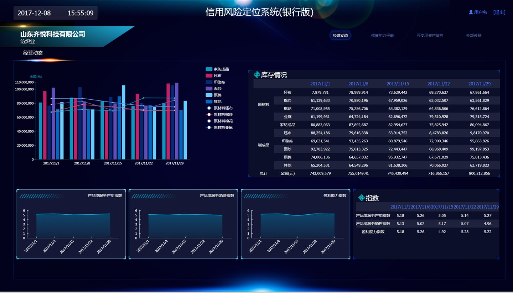

# 07 · 金融风控（A4 表格优先）

> 覆盖：`finance-risk`（银行企业信用风险实时监测）
> 

## 1. 一眼判断

| | |
|---|---|
| **最适合** | 银行风控、信用评级、企业授信、贷后监测 |
| **不适合** | 需要炫酷地图/3D 的场景（金融要的是「可信」，不是「炫」） |
| **难度** | ★★☆ |
| **技术栈** | jQuery 1.12 + ECharts 3.7 + 多页（index / sanlian / xiangqing） |

## 2. 结构

```
.wrap > .wid_1820（固定 1820 宽）
├─ .header   左时间 / 中系统名 / 右用户
├─ .title    实时监测 - 企业名单
└─ .content
   ├─ .tb_left  AAA 企业表
   ├─ .tb_right AA+ 企业表
   ├─ .tb_left  AA 企业表
   └─ .tb_right AA- 及以下企业表
```

**表格是大屏主角**，不是图表。这在金融/审计类项目里很常见。

## 3. 配色

| 角色 | 值 |
|---|---|
| 背景 | `#0c0f2b` / `#0b0f2a` |
| 主蓝 | `#003bcf` / `#487bff` |
| 结构线 | `#1f223c` |
| 文字 | `#fff` / `#cccccc` |
| 危险 | `#ff4d4f`（评级下调/逾期） |
| 正向 | `#2ecc71`（评级上调） |

低饱和、无霓虹、无渐变。**克制是金融视觉的核心。**

## 4. 模块 → 图表

| 模块 | 组件 |
|---|---|
| 企业信用分级表 | HTML table（4 组） |
| 风险指标趋势 | `line`（详情页） |
| 评级分布 | `pie` / `bar` |
| 关联关系 | `graph`（sanlian.html） |
| 企业详情 | `xiangqing.html` |

## 5. 改造锚点

| 要改 | 位置 |
|---|---|
| 标题 | `.hefont`、`<title>` |
| 表头/列 | `.table1 .tb_title` |
| 行数据 | `.table1 tr`（注意原模板有 `<td>` 未闭合的写法） |
| 行悬停 | `<style>` 里的 `.tb>table tr:hover` |
| 点击跳转 | 底部 `<script>` 里的企业名判断 |
| 配色 | `css/index.css` 的 `#003bcf`、`#0c0f2b` |

## 6. 表格大屏的规范

| 项 | 建议 |
|---|---|
| 行高 | 36–44px（投屏），不要 24px |
| 字号 | 14px 起 |
| 列数 | ≤ 6 列；超过就拆成两张表 |
| 对齐 | 文本左对齐、数字右对齐、评级居中 |
| 斑马纹 | 用极低对比（`rgba(255,255,255,.03)`），不要明显条纹 |
| 排序 | 默认按风险/金额降序，并在标题注明 |
| 溢出 | 企业名省略号 + `title`；不要换行撑高行 |
| 颜色 | 评级用色块 + 文字，不只靠颜色 |

## 7. 合规与信任感

- 明确标注「数据截至时间」「评级模型版本」「数据来源」。
- 不展示真实企业名/统一社会信用代码（演示用虚构名，如「示例科技有限公司」）。
- 风险等级用行业惯例（AAA/AA+/AA/AA-/A…），不要自创符号。
- 涨跌用 ▲▼ + 颜色 + 数值，三重编码。
- 避免「实时」滥用：如果数据 T+1，就写「T+1」。

## 8. 改造建议

- **M 模式**：starter 的 A4 布局 + 表格组件，改成「左表 + 右详情」两栏；图表只保留 1–2 个趋势。
- **R 模式**：直接改 4 张表的表头和数据；注意原 HTML 有未闭合 `<td>`，浏览器会自动修正，但改成模板字符串时容易错位。
- 增加「搜索/筛选」时，用顶部一行控件，不要弹窗。

## 9. 坑

- `wid_1820` 固定宽度在 1920 屏上两侧各留 50px，看起来像「没铺满」；可改 `width:100%; max-width:1820px`。
- ECharts 3.7 的 `graph` 与 5 差异较大，迁移时重写。
- 表格行点击跳转用 `window.location.href`，多页部署时路径要对。
