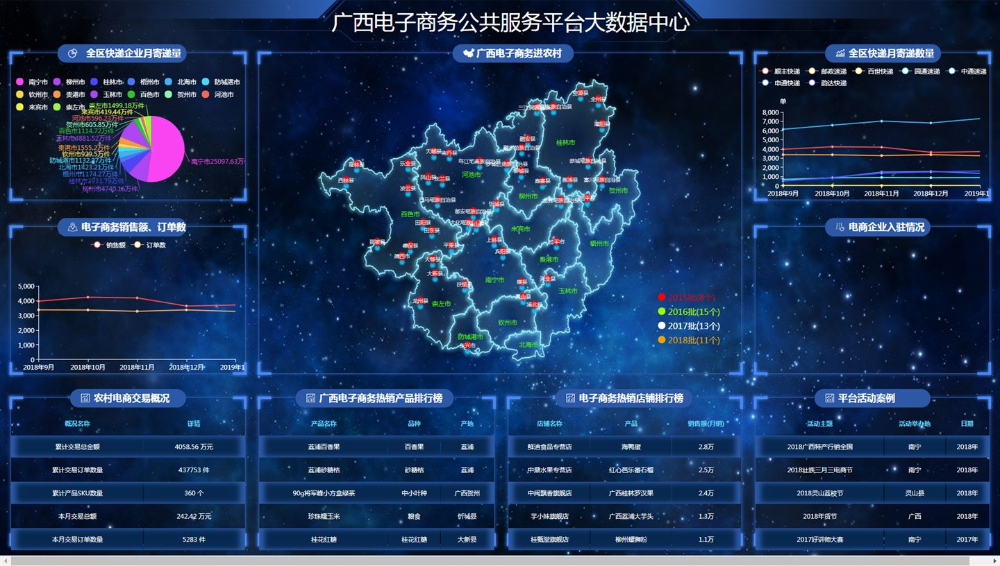
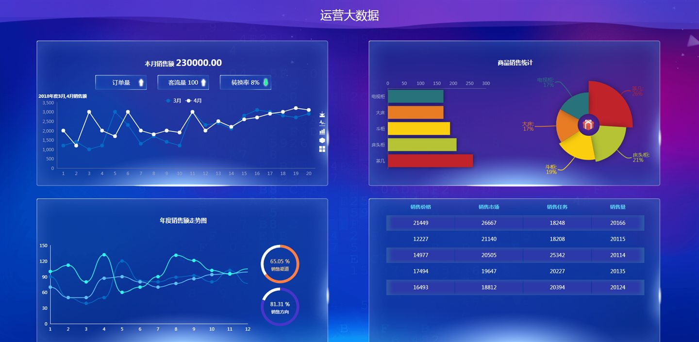

# 08 · 电商运营（A1 / A4）

> 覆盖：`ecommerce-gov`（电子商务公共服务平台）、`operation`（运营大数据）
> 
> 

## 1. 一眼判断

| 模板 | 场景 | 原型 | 气质 |
|---|---|---|---|
| ecommerce-gov | 电商公共服务、县域电商、产业带 | A1 | 深蓝，中心地图 + 交易流向，偏「政府平台」 |
| operation | 运营分析、增长看板、月度经营会 | A4 | 深蓝 + 亮蓝/紫，表格 + 图表，偏「互联网」 |

## 2. ecommerce-gov · 电商公共服务

### 结构

```
.header（标题 + 导航 + 时间）
.data_content
├─ .main_left   左列：网络零售额、农产品上行、店铺/品牌
├─ 中心         区域地图 + 交易流向
└─ 右列         品类排行、物流时效、店铺榜
```

### 配色

`#0a1f3d` 底、`#2c58a6` 主蓝、`#337ab7` 次蓝、`#00d4ff` 强调、`#ffcc00` 暖色。

### 模块

网络零售额、农产品上行、店铺/品牌数、物流时效、区域交易地图、品类排行。

### 改造锚点

- `.header_nav`、`.t_title`、`.data_main`、`.main_left`、`.left_1`
- 地图：中心 `echarts.init` 的 `geo` + `effectScatter` + `lines`
- 配色：`css/` 中 `#2c58a6`

### 坑

- 金额单位（万元/亿元）必须全屏统一，标题标注。
- 区域名与 GeoJSON 必须一致。
- 交易流向线太多会糊；只保留 TOP 8–12 条。

## 3. operation · 运营大数据

### 结构

```
.t_container
├─ .t_header   标题
├─ .t_main
│  ├─ .t_box    左 KPI 列（GMV/订单/客单价/转化率）
│  ├─ .t_list   渠道/品类列表
│  └─ .echart   右侧 2×3 图表
└─ .main_table  底部表格（可选）
```

### 配色

`#0b1a3a` 底、`#2c58a6` 主蓝、`#61d2f7` 亮青、`#2b3aa8` 深紫蓝。
比 ecommerce-gov 更「年轻」，可加紫色品类色。

### 模块

GMV/订单/客单价、渠道趋势、转化漏斗、品类占比、区域排行。

### 改造锚点

- `.t_number`（KPI 数字）、`.t_title`、`.t_list`、`.echart`
- 配色：`css/` 中 `#61d2f7`、`#2b3aa8`

## 4. 电商指标口径（必须统一）

| 指标 | 定义 | 单位 |
|---|---|---|
| GMV | 成交总额（含未付款/退款？需注明） | 万元/亿元 |
| 订单量 | 支付订单数 / 下单数 | 单 |
| 客单价 | GMV ÷ 支付订单数 | 元 |
| 转化率 | 支付人数 ÷ 访客数 | % |
| 复购率 | 二次购买人数 ÷ 购买人数 | % |
| 退款率 | 退款订单 ÷ 支付订单 | % |

**没有口径的数字 = 没有意义**。标题或脚注写明「近 30 天 / 支付口径 / 不含退款」。

## 5. 改造建议

- **ecommerce-gov** → 适合「政府电商示范县/产业带」，强调区域 + 农产品 + 物流。
- **operation** → 适合「品牌电商运营」，强调趋势 + 漏斗 + 品类。
- 两者都可映射到 starter：ecommerce-gov 用 A1（中心地图），operation 用 A4（KPI + 图表网格）。
- 电商大屏最常见的错误是「指标太多、口径不一」；先砍到 6 个 KPI。

## 6. 坑

- GMV 用 `Intl.NumberFormat` 格式化，不要手写 `toFixed(2)` 后拼接。
- 漏斗各层人数必须单调递减；否则检查口径。
- 同比/环比要写基期（去年同周/上周）。
- 紫色在 LED 上容易偏色，控制在品类色，不做背景。

## 7. 复用清单

| 组件 | 来源 | 用途 |
|---|---|---|
| 区域交易地图 | ecommerce-gov | 产业带/县域 |
| KPI 左列 | operation | A4 左栏 |
| 转化漏斗 | chart-recipes 第 9 节 | 运营 |
| 品类环图 | 01 模板 | 通用 |
| 滚动订单表 | 01 retail | 实时成交 |
