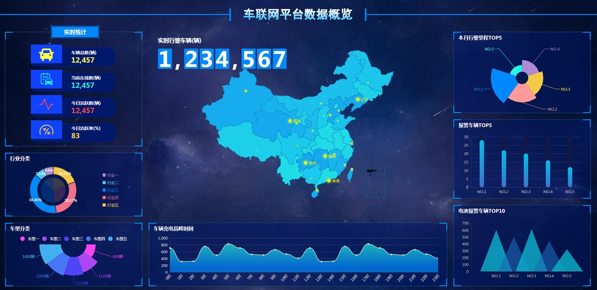
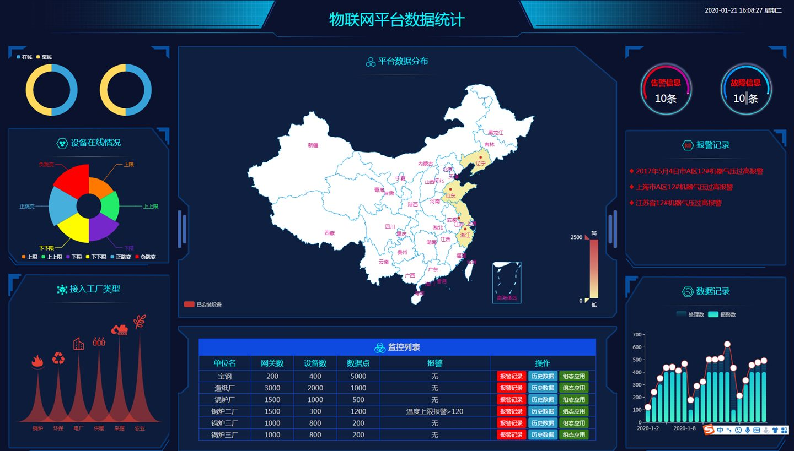

# 09 · 车联网 / 物联网（A3 / A4）

> 覆盖：`vehicle`（新能源车联网）、`iot`（物联网平台数据统计）
> 
> 

## 1. 一眼判断

| 模板 | 场景 | 原型 | 技术 |
|---|---|---|---|
| vehicle | 车联网、新能源运营、车队管理 | A3 全屏地图 + 浮层 | jQuery + ECharts 4 |
| iot | IoT 平台、设备统计、Vue 项目 | A4 网格卡片 | Vue 2 + jQuery + ECharts 4 |

## 2. vehicle · 车联网

### 结构

```
.data
├─ .data-title     顶部标题（左/中/右三段）
├─ .data-content
│  ├─ .con-left    左上浮层：车辆总数/在线/里程
│  ├─ 全屏地图      车辆点位 + 轨迹 + 充电桩
│  └─ 右侧浮层      能耗/故障/区域热力
└─ 底部状态条
```

### 配色

`#0a1f3d` 底、`#0089ff` 主蓝、`#25f3e6` 青、`#ffff44` 黄、`#f84a4a` 红。

### 模块

车辆总数/在线、里程/能耗、故障告警、充电桩分布、轨迹回放、区域热力。

### 改造锚点

- `.data-title`、`.data-content`、`.con-left`、`.info-title`
- 地图：`echarts.init` + `geo` + `effectScatter` / `lines`
- 配色：`css/` 中 `#0089ff`、`#25f3e6`

### 坑

- **坐标系**：GPS 原始点（WGS-84）直接画在中国地图（GCJ-02）上会偏移 300–500m；必须转换。
- 轨迹回放需要按时间排序 + 分段渲染；不要一次画 10 万个点。
- 车辆点位 > 500 时关闭涟漪，用纯 `scatter` + `large:true`。
- 充电桩/车辆/故障点要用不同 symbol，不只靠颜色。

## 3. iot · 物联网数据统计

### 结构

```
.content_left    设备在线/类型分布
.content_center  中心地图/拓扑 + 上下指标
右侧              告警/趋势/实时数据流
```

### 配色

`#0b122e` 底、`#1d3152` 面板、`#00f6ff` 青、`#ff6f05` 橙、`#ff0000` 告警。

### 模块

设备在线率、告警趋势、类型分布、区域分布、实时数据流。

### 技术注意

- Vue 2 已停止维护；新项目用 Vue 3 或原生 JS。
- Vue + jQuery 同时操作 DOM 会冲突；二选一。
- ECharts 实例要放在 Vue 的 `mounted` 里，`beforeUnmount` 时 `dispose`。

## 4. 设备/车辆指标的通用口径

| 指标 | 定义 | 注意 |
|---|---|---|
| 在线率 | 在线设备 ÷ 总设备 | 心跳超时阈值要注明（如 5 分钟） |
| 故障率 | 故障设备 ÷ 总设备 | 与「告警数」区分 |
| 利用率 | 运行时长 ÷ 可用时长 | 车辆/设备不同 |
| 里程 | 当日/累计 | 单位 km |
| 能耗 | kWh/百公里 或 kWh/台 | 新能源车用前者 |
| 告警 | 按等级分 | 未闭环/已闭环 |

## 5. 改造建议

- **vehicle**：保留全屏地图 + 四周浮层；把「轨迹回放」做成可选交互，默认只显示实时点位。
- **iot**：改成 A4 网格更稳；设备类型/区域/告警三张图 + 一张在线率仪表盘即可。
- 两者都需要「设备详情」下钻：点击点位 → 右侧抽屉/弹窗，不要跳新页面。

## 6. 坑

- `ith` 类模板用固定 px + 绝对定位，换分辨率会错位；改 scale。
- WebSocket 推送高频点位（>1Hz）时要做节流/聚合，否则浏览器卡死。
- 地图底图不要用卫星图（信息干扰大），用深色矢量底图。
- 设备离线状态要区分「从未上线」和「刚离线」。

## 7. 复用清单

| 组件 | 来源 |
|---|---|
| 全屏地图 + 浮层 | vehicle 的 `.data-content` |
| 车辆/设备点位 | `effectScatter` + `symbolSize` 映射 |
| 充电桩分布 | `scatter` + 自定义 symbol |
| 在线率仪表盘 | chart-recipes 第 7 节 |
| 设备类型环图 | 01 模板 |
