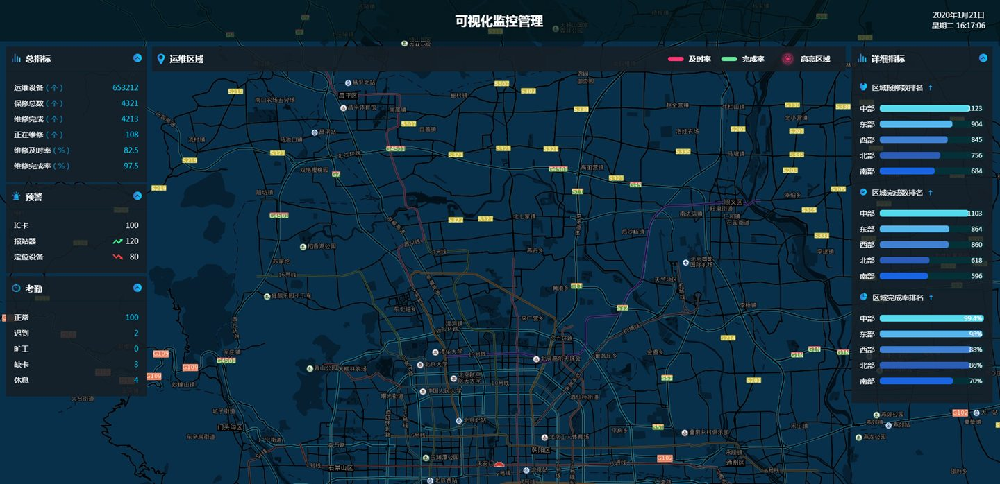
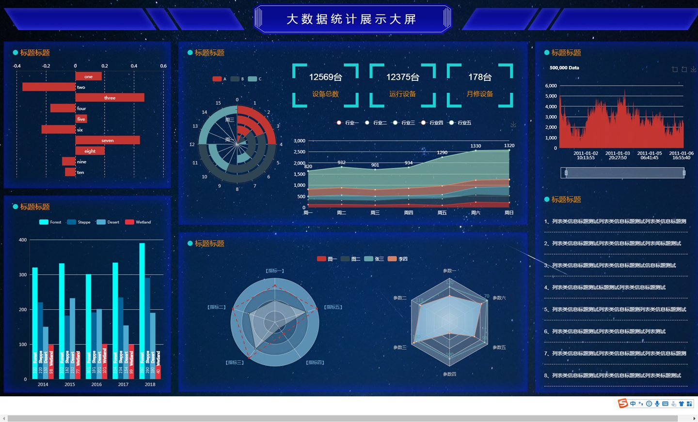
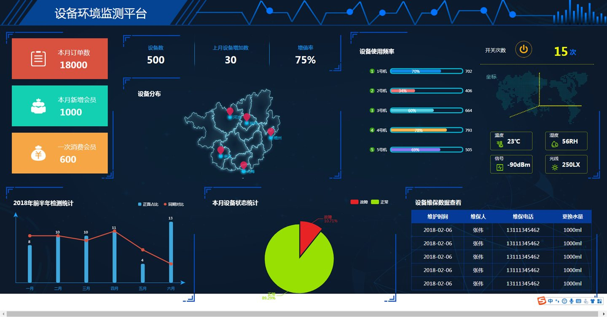

# 10 · 运维 / 统计 / 设备（A3 / A4）

> 覆盖：`ops-map`（百度地图监控）、`stats`（统计展示）、`device`（设备环境监测）
> 
> 
> 

## 1. 选型对照

| 模板 | 场景 | 原型 | 关键点 |
|---|---|---|---|
| ops-map | 运维巡检、街道级定位 | A3 | 真实底图（百度地图 API） |
| stats | 月度/年度统计汇报 | A4 | 报表风，低改造难度 |
| device | 设备/环境监测 | A4 | 大色块 KPI + 地图 + 表格 |

## 2. ops-map · 百度地图监控

### 结构

```
#mapContainer（全屏百度地图，midnight 样式）
├─ .nav-top      标题 + 日期时间
├─ .legend-container  图例（及时率/完成率/高亮）
├─ 左浮层        总指标（6 项）
├─ 右浮层        工单/告警列表
└─ 点位          自定义 marker + 高亮区域
```

### 配色

`#052025` / `#043037` 底、`#00cefa` 主青、`#ff3774` 红（及时率）、`#6ae89c` 绿（完成率）。

### 技术要点

- 百度地图 JS API 2.0，需要 AK + 域名白名单；**内网必须离线瓦片**。
- 地图样式 `midnight` 是百度内置深色样式。
- 自定义 marker 用 `BMap.Marker` + `Icon`；大量点位用 `MarkerClusterer`。
- 坐标系是 BD-09，与 GPS/高德/腾讯都不同；后端要统一转换。
- 商用授权：百度/高德/天地图都有许可限制，交付前确认。

### 改造锚点

- 标题：`.nav-top-title`
- 指标：`.zhzb-li-name` / `.zhzb-li-num`
- 图例：`createLegend()` 函数
- 点位：`drawMap(mapData, map)` 函数
- 配色：`css/` 中 `#ff3774`、`#6ae89c`

### 坑

- AK 写在前端会被盗用；用域名白名单 + 服务端代理。
- 地图容器必须有明确高度，否则灰色。
- `map.loaded` 是自定义属性，不是百度事件；不要依赖。
- 全屏地图 + 浮层时，浮层要 `pointer-events:none`，子元素再开启，否则地图不能拖动。

## 3. stats · 统计展示

### 结构

Bootstrap 栅格：`row` → `col-lg-3`（左 KPI 列）+ `col-lg-6`（中图表）+ 右列。
模块：总量、月度趋势、分布对比、雷达评估、排行榜。

### 配色

`#0d2b52` 底、`#337ab7` 主蓝、`#5bc0de` 浅蓝、`#fff` 文字。

### 改造建议

- 报表风容易「显旧」：加细线框、留白、统一 8px 间距即可现代很多。
- 把 Bootstrap 的 `col-lg-*` 换成 CSS Grid（12 列），去掉栅格依赖。
- 适合「月度/年度总结」类汇报，不适合实时监控。

## 4. device · 设备环境监测

### 结构

```
.t_container
├─ .t_header          标题 + 顶部波形装饰
├─ .t_main
│  ├─ .t_left_box     3 个大色块 KPI（红/绿/橙）
│  ├─ 中上           设备数/增量/增值率
│  ├─ 中            设备分布地图
│  ├─ 右上           设备使用频率条
│  ├─ 右            开关次数/坐标/温湿度/信号
│  ├─ 左下           检测统计（柱+线）
│  ├─ 中下           设备状态饼图
│  └─ 右下           维保表格
└─ .t_bottom_box
```

### 配色

`#0a1f3d` 底、`#f0553f` 红、`#16c9a3` 绿、`#f6a645` 橙、`#1aa1fd` 蓝。

**特点**：三个高饱和大色块 KPI，是全屏视觉锚点。

### 改造建议

- 大色块最多 3 个；超过 3 个会像「调色盘」。
- 红/绿同时大面积使用对色弱不友好 → 加图标 + 文字。
- 设备使用频率条用 `bar` + `showBackground`，阈值变色。
- 表格行数 ≤ 6，否则滚动。

## 5. 三者共同的运维指标

| 指标 | 说明 |
|---|---|
| 设备总数 / 在线 | 心跳阈值 |
| 告警数 / 未闭环 | 按等级 |
| 及时率 / 完成率 | 工单口径 |
| MTTR | 平均修复时长 |
| 巡检完成率 | 计划 vs 实际 |
| 环境值 | 温湿度/噪声/PM2.5/信号 |

## 6. 改造优先级

1. **device** 最适合快速改：结构清晰、图表标准、配色可换。
2. **stats** 最适合统计汇报：改数据即可，视觉提升空间大。
3. **ops-map** 只在必须街道级定位时用；否则用 ECharts 地图更轻、更可控。

## 7. 坑

- 百度地图/高德地图的授权、坐标系、离线瓦片是三座大山；能不用就不用。
- 设备类大屏的「实时」通常是 30s–5min 轮询，不要写「毫秒级」。
- 大色块 KPI 与深色背景的对比度要 ≥ 4.5:1。
