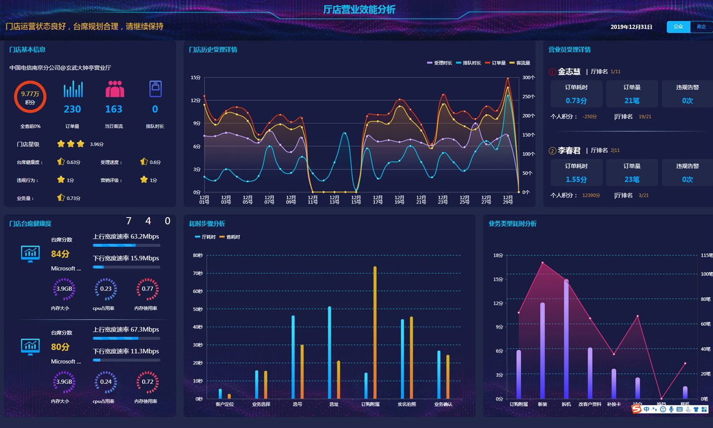

# 11 · 门店 / 营业厅（A4）

> 覆盖：`store`（厅店效能大屏监控看板）
> 

## 1. 一眼判断

| | |
|---|---|
| **最适合** | 连锁门店、运营商营业厅、区域经营对比 |
| **不适合** | 需要全国地图/轨迹的场景 |
| **难度** | ★☆☆（最容易改的一类） |
| **技术栈** | jQuery + ECharts 4 + bootstrap 栅格 |

## 2. 结构

```
.container-fluid
├─ .office-header    标题 + 时间 + 筛选
└─ .office-efficiency-index
   ├─ 左列  厅店排行 / 客流
   ├─ 中列  核心指标 + 趋势 / 业务办理
   └─ 右列  满意度 / 员工绩效
```

Bootstrap 的 `col-sm-* / col-md-*` 栅格，12 列。

## 3. 配色

`#0a1c3a` 底、`#428bca` 主蓝、`#00d4ff` 青、`#fff` 文字。
比 01 更「企业内刊」，少装饰、多表格。

## 4. 模块 → 图表

| 模块 | 图表 |
|---|---|
| 厅店排行 | 横向条 + 排名数字 |
| 客流/成交 | `line` 双线 |
| 业务办理 | `bar` 堆叠 |
| 满意度 | `gauge` / `pie` |
| 员工绩效 | 表格 + 进度条 |

## 5. 改造锚点

- `.office-header`、`.title-info`、`.analysis-info`、`.analysis-filter`
- 栅格：`col-sm-*` / `col-md-*`
- 图表：`echarts.init` 的 3–5 个实例

## 6. 改造步骤

1. 把 bootstrap 栅格换成 CSS Grid（12 列），去掉 `col-*` 依赖。
2. 厅店名从 mock 数据来，处理长名称：省略号 + 完整名 `title`。
3. 排名并列：`1, 1, 3`，不要 `1, 2, 3`。
4. 区域筛选（省/市/区）用 URL 参数或全局状态，不要每个图表各写一份。
5. 满意度低于阈值时变红，并在标题旁显示「低于目标」。

## 7. 指标口径

| 指标 | 定义 |
|---|---|
| 客流 | 进店人数（去重） |
| 成交率 | 成交单数 ÷ 客流 |
| 客单价 | 销售额 ÷ 成交单数 |
| 业务办理量 | 按业务类型分 |
| 满意度 | 评价均分（1–5 或 0–100） |
| 员工绩效 | 销售额/办理量/满意度加权 |

## 8. 坑

- 门店数量多时排行榜要分页/滚动，不要一屏塞 20 行。
- 中文字段名长（「XX 路营业厅」），图表 left margin 要够。
- 地图不是必须的；门店类大屏用「区域排行 + 热力」更实用。
