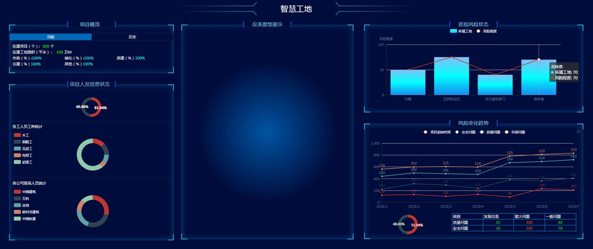
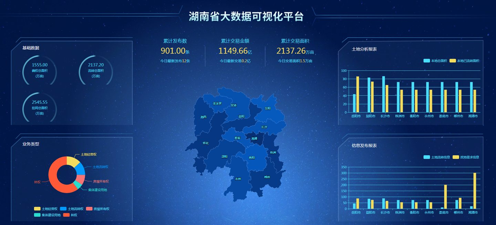

# 12 · 工地 / 3D 地图（A4 / A3）

> 覆盖：`construction`（智慧工地）、`land-3d`（土地交易 3D）
> 
> 

## 1. 一眼判断

| 模板 | 场景 | 原型 | 难度 |
|---|---|---|---|
| construction | 工地/园区环境监测 | A4 | ★☆☆ |
| land-3d | 国土/地块/3D 汇报 | A3 | ★★★ |

## 2. construction · 智慧工地

### 结构

```
顶部 .caption-title（标题 + 装饰）
├─ 左列   环境（扬尘/噪声/温湿度）、人员实名制
├─ 中列   塔吊/升降机、工地视频/地图
└─ 右列   告警列表、设备状态
```

### 配色

`#000c3b` 底、`#032d60` 面板、`#26c6f0` 主青、`#00ffff` 高亮、`#00a0e9` 蓝。

### 模块 → 图表

| 模块 | 图表 |
|---|---|
| 环境监测 | `line`（多指标）/ 仪表盘 |
| 人员实名制 | `bar` / 饼图 |
| 塔吊/升降机 | `radar` / 状态卡 |
| 告警 | 列表 |
| 视频 | 视频/占位图 |

### 改造锚点

`.caption-title`、`.biaoti`、`.zhenwen`、`.left_zs`、`.data-box1`、`.data-title`

### 坑

- 固定 px 布局在不同分辨率会留白/裁切 → 改 scale。
- 环境数据要标单位（μg/m³、dB、℃、%RH）。
- 视频只是辅助，不要占超过 1/4 屏。

## 3. land-3d · 土地交易 3D

### 结构

```
.main
├─ .top_title        标题
├─ .datas            左右浮层数据
├─ 中心 3D 地图       map3D + bar3D/scatter3D
└─ 底部/右侧         排行、成交、溢价率
```

### 配色

`#04122e` 底、`#4adefe` 冰蓝、`#4e72b0` 结构、`#f3db5c` 强调。

### 技术要点

- `echarts-gl` 2.x + ECharts 5.4（版本必须匹配）。
- `map3D` 需要注册 GeoJSON；`bar3D` 的 `coordinateSystem:"geo3D"`。
- `viewControl.autoRotate` 建议关闭（长时间投屏会晕）。
- 低端设备/无 WebGL → 降级为普通 `map`。

### 改造锚点

`.main`、`.top_title`、`.datas`、`.data_left`、`.left_top`、`.left_main_circle`、`.counter-value`

### 坑

- `echarts-gl` 包体大、帧率低；LED 拼接屏可能花屏。
- 3D 地图的 `boxHeight`/`regionHeight` 调大会遮挡数据。
- 3D 场景里文字标签容易反向/被遮挡；关键数值放 2D 浮层。
- 地块数据用 `scatter3D` 时，高度表示「价格/面积」要在图例说明。

## 4. 3D 使用原则

| 原则 | 说明 |
|---|---|
| 有数据含义 | 高度/颜色必须映射真实字段，不做纯装饰 |
| 有 2D 降级 | WebGL 失败时显示普通地图 |
| 不自动旋转 | 或提供暂停按钮 |
| 不超过 1 个 3D 主视觉 | 多个 3D 图会互相抢注意力 |
| 性能预算 | 首屏 < 3s，帧率 ≥ 30fps |

## 5. 推荐落地

- 工地/园区 → 用 A4（device 的结构）+ 环境仪表盘，最稳。
- 国土/地块 → 用 3D 地图 + 左右浮层，但准备 2D 版本。
- 如果客户只是「想要 3D 感」，用 2.5D 倾斜地图（CSS transform / ECharts geo + 阴影）成本更低。
