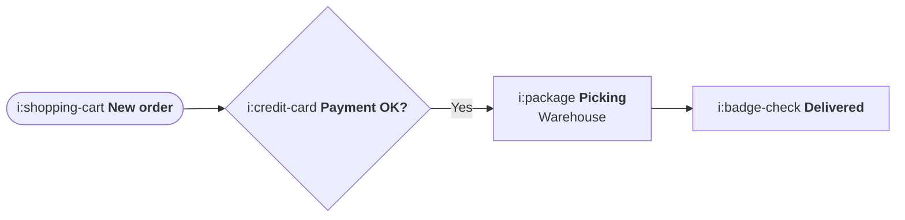

# Pastel diagrams

Write the diagram as Mermaid in a `.mmd` file, then render it with the bundled script. The script adds the house style (palette, font, icons, rounded corners), so the `.mmd` stays short and readable.

## One-time setup

The skill needs Node.js 18+ and an installed Chrome, Edge or Chromium (no browser download).

```bash
cd <this skill folder> && npm install
```

If no browser is found, set `CHROME_PATH` to the browser executable. Without a clone, `npx --yes github:mustafa-patharia/pastel-diagrams <file|folder>` runs the same script.

## Workflow

1. **Pick the shape.**

   | Content | Mermaid type |
   |---|---|
   | Process, architecture, decisions | `flowchart LR` (left to right) or `flowchart TB` (top to bottom) |
   | Status lifecycle, state machine | `stateDiagram-v2` with `direction LR` |
   | Messages between parties over time | `sequenceDiagram` |
   | Tables and relationships | `erDiagram` with `direction LR` |
   | Phases and milestones | `timeline` |
   | Brainstorm, topic breakdown | `mindmap` |
2. **Write the `.mmd` file** next to the document that uses it (for example `docs/diagrams/src/order-flow.mmd`). Optional first line `%% title: Order flow` sets the HTML page title.
3. **Render with the layout check:**
   ```bash
   node <this skill folder>/scripts/render.mjs docs/diagrams/src --out docs/diagrams --check
   ```
   Accepts files or folders. Without `--out`, output goes next to each `.mmd`. Each diagram gives `name.svg`, `name.png` (3x), `name.html` and `name.auto.svg` (switches light/dark with the viewer's system setting; use it in GitHub READMEs).

   | Option | Effect |
   |---|---|
   | `--theme pastel\|mono\|corporate\|high-contrast\|<file.json>` | Palette, font, corner radius and connector colours (default `pastel`). `mono` prints well; `corporate` suits business documents; `high-contrast` for accessibility. |
   | `--dark` | Dark variant of the theme. |
   | `--edges curved` | Mermaid's curved connectors instead of the default straight ones between card side centres (flowcharts, state diagrams). |
   | `--formats png,svg` | Only these outputs (any of `svg,png,html,auto`). |
   | `--scale 2` | PNG resolution (default 3). |
   | `--md` | Folders: render ```` ```mermaid ```` blocks in `.md` files (see below). |
4. **Fix layout problems, then render again.** After each diagram the script prints a check line, for example:
   ```
   ok   architecture  ->  docs/diagrams/architecture.{svg,png,html,auto.svg}
        check WARN 7 nodes, 7 edges, 1 crossings, 0 overlaps, 0 clipped
          - edge "API Node.js → Cache Redis" crosses edge "Background jobs Queue worker → Email service"
   ```
   With `--check` the exit code is `2` while any diagram has crossing edges, an edge running through another node, overlapping labels or clipped labels. `--json` prints the same report as JSON. Repeat until the check is clean, trying these in order:
   - **Crossing edges:** reorder node declarations (Mermaid places nodes in the order they first appear) and list edges in the same order as the main path; swap two nodes inside a `subgraph`.
   - **Edge through a node / long back-edge:** change direction (`LR` ↔ `TB`), or move the node into or out of a `subgraph`.
   - **Overlapping or clipped labels:** shorten the label or edge label, or move detail into the subtitle.
   - **More than 12 nodes** (a warning, not an error): split the diagram in two.

   Look at the PNG once the check is clean, before using it.
5. **Embed** the PNG in Markdown/Word/slides, or the SVG on the web. The HTML is a standalone page for sharing.

## Flowchart syntax with the house style



- **Icons:** `i:<lucide-name>` anywhere in a label, e.g. `i:database`, `i:user`, `i:send`. Names come from https://lucide.dev/icons; an unknown name stops that diagram with an error naming the icon.
- **Title + subtitle:** `<b>Title</b><br/><span class='s'>Subtitle</span>`. Keep subtitles to a few words.
- **Card classes** (append `:::name` to a node):

  | Class | Use for |
  |---|---|
  | `grey` | Start, neutral, inactive |
  | `sky` | In progress, user-facing parts |
  | `lav` | Services, processing, main components |
  | `mint` | Success, done, data stores |
  | `yellow` | Waiting, warning, needs attention |
  | `peach` | Errors, rejected, external notifications |
  | `decision` | Decisions (dashed amber; use the `{ }` diamond shape) |
  | `ext` | External systems and people outside the boundary |

- **Shapes:** `["card"]`, `(["pill / start"])`, `{"decision"}`, `[("database")]`.
- **Groups:** `subgraph id["Group name"] ... end` draws a faint tinted panel with an uppercase caption.
- **Edge labels:** `a -- "Label" --> b`. Keep them to 1–3 words.

## Sticky notes and stickers (flowcharts, state diagrams)

For review comments and reactions, add comment lines anywhere in the `.mmd` (Mermaid ignores them; other Mermaid tools render the diagram without them):

```
%% note pay: Add Apple Pay before launch | Product | green
%% sticker pay: +1
%% sticker done: 🎉
%% sticker guest: 👀 | top-left
%% sticker web: WIP | orange
```

- `note <node id>: text | author | colour` draws a sticky note in the nearest free space by that card. Author and colour are optional; colours: `yellow` (default), `green`, `pink`, `blue`, `purple`, `orange`.
- `sticker <node id>: text or emoji | corner | colour` pins a die-cut sticker to a card corner (`top-right` default, `top-left`, `bottom-right`, `bottom-left`). Emoji come from Twemoji (about 3,700); text stickers take a colour: `purple` (default), `green`, `pink`, `blue`, `orange`, `red`, `yellow`.
- Keep notes to one or two sentences and use at most a few per diagram. An unknown node id prints a warning.

## Style rules

- One idea per diagram; about 4–12 nodes. Split bigger flows into several diagrams.
- Use colour to mean something (state or role), consistently across a document's diagrams, not for decoration.
- Short labels in sentence case. No full sentences inside nodes.
- Avoid crossing lines and long back-edges; prefer a clear main path from left to right or top to bottom.
- Do not add custom `classDef`, `style` or `%%{init}%%` blocks; they override the house style.

## Other diagram types

- **State diagrams:** card classes and `i:` icons work. Give states readable labels with `state "i:inbox <b>Open</b>" as Open`, then colour them with `class Open grey` lines at the end.
- **ER diagrams:** colour entities with `CUSTOMER:::sky { ... }`. Attribute rows alternate automatically.
- **Sequence diagrams:** plain Mermaid syntax; actors, lines and notes are styled automatically. No card classes or icons.
- **Timeline and mindmap:** plain Mermaid syntax; sections and branches cycle through the palette (lav, sky, mint, peach, yellow, grey).

## Markdown files

```bash
node <this skill folder>/scripts/render.mjs docs/guide.md                    # one file
node <this skill folder>/scripts/render.mjs docs --md --out build/docs        # every .md in a folder
```

Each ```` ```mermaid ```` block is rendered to `diagrams/<file>-<n>.{svg,png}` and a copy of the Markdown is written with the blocks replaced by image links: `guide.rendered.md` next to the source, or `<out>/guide.md` with `--out`. The source file is never changed. `--md-image svg` or `--md-image auto` links the SVG or the light/dark SVG instead of the PNG. A `%% title: ...` line inside a block sets the image alt text.

## Custom themes

Copy `themes/pastel.json` (and `themes/pastel-dark.json` for dark mode) to `my-theme.json` / `my-theme-dark.json`, change the colours, and pass `--theme path/to/my-theme.json`. Check text contrast with `node <this skill folder>/scripts/check-themes.mjs path/to/my-theme.json` (WCAG AA: 4.5:1 for text, 3:1 for icons).

## Examples

`examples/` holds `.mmd` sources with their rendered SVG, PNG, HTML and auto SVG (dark renders in `examples/dark/`): an order lifecycle with a decision, a checkout review with sticky notes and stickers, a web app architecture with groups, a sign-in sequence, support ticket states, a shop data model, a release timeline and a launch mindmap. `examples/github-action/render-diagrams.yml` renders every `.mmd` in a repository on push.
