<h1 align="center">placeforge-landmark</h1>

<p align="center">
  <b>Rebuild a real place in 3D from photos, a map pin and a radius.</b><br>
  A skill for <a href="https://claude.com/claude-code">Claude Code</a>. Blender stills, a film and an interactive Three.js page, all from one scene description.
</p>

<p align="center">
  <a href="https://bishrulhaq.com/demos/lotus-tower-3d.html"><b>Live 3D demo</b></a>
  &nbsp;·&nbsp;
  <a href="examples/lotus-tower/media/lotus_tower_film.mp4"><b>Watch the film</b></a>
  &nbsp;·&nbsp;
  <a href="https://bishrulhaq.com/posts/rebuild-any-landmark-in-3d"><b>Read the article</b></a>
  &nbsp;·&nbsp;
  <a href="examples/lotus-tower"><b>Lotus Tower example</b></a>
</p>

<p align="center">
  
  
  
  
  
</p>

<p align="center">
  <a href="examples/lotus-tower">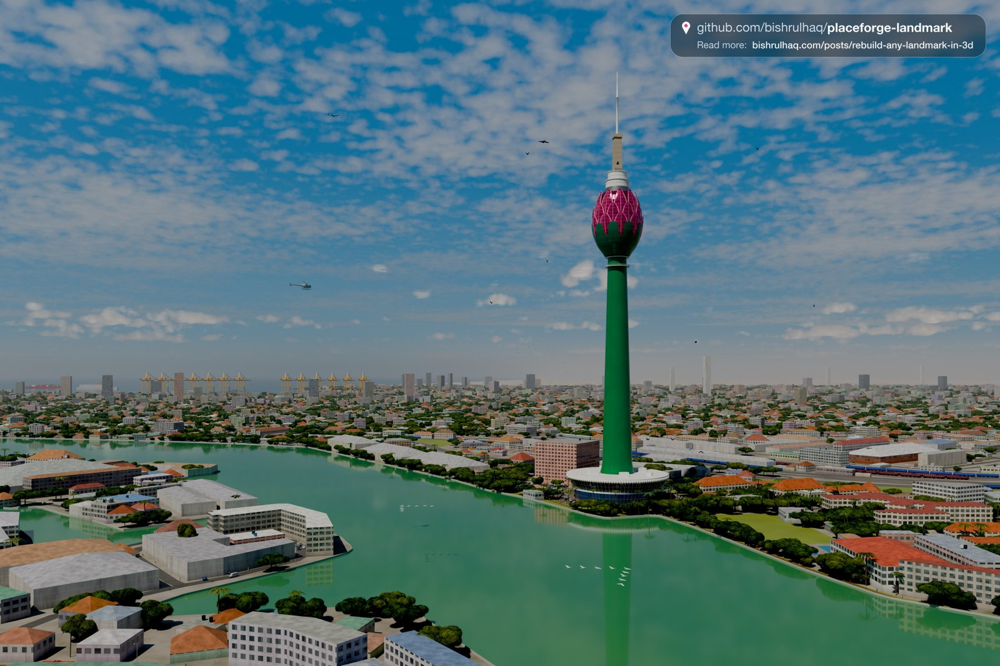</a>
</p>

<p align="center"><sub>The Lotus Tower, Colombo: rebuilt from a few photos, a map pin and a 900 m radius. Not a photograph.</sub></p>

<p align="center">
  <a href="examples/lotus-tower/media/lotus_tower_film.mp4">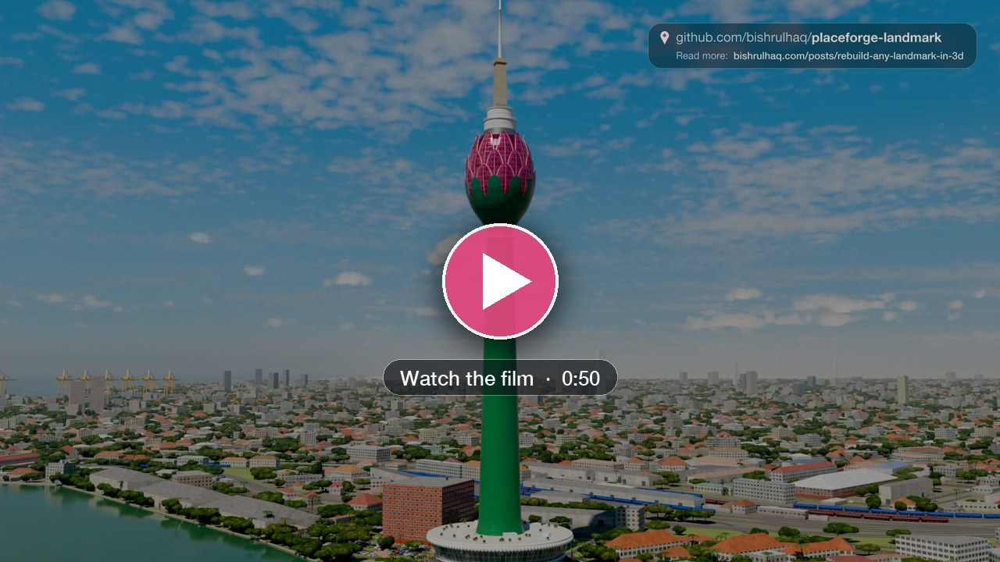</a>
</p>

<p align="center"><sub>The film: 50 seconds, day, sunset and night, with sound. Click to play.</sub></p>

## What it does

You give it reference photos of a place, where it is on the map and how many metres around it you want. It builds
the place in Blender on real OpenStreetMap data, models the landmark from your photos, and then improves the result
in a loop: render, compare with the photo by numbers and by eye, fix the worst gap, render again.

<div align="center">
<table>
  <tr>
    <td align="center" width="33%"><a href="examples/lotus-tower">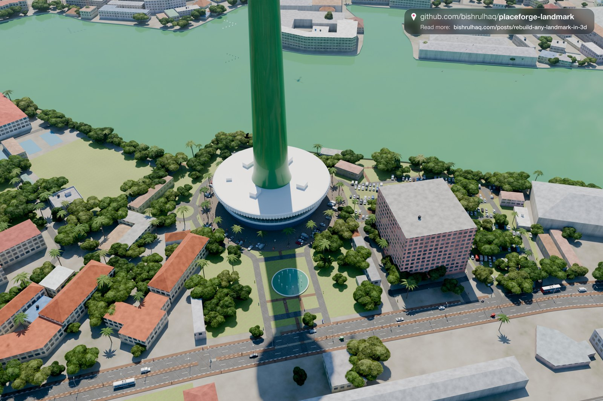</a><br><b>Stills</b><br><sub>Blender Cycles, matched to your reference photo</sub></td>
    <td align="center" width="33%"><a href="examples/lotus-tower/media/lotus_tower_film.mp4">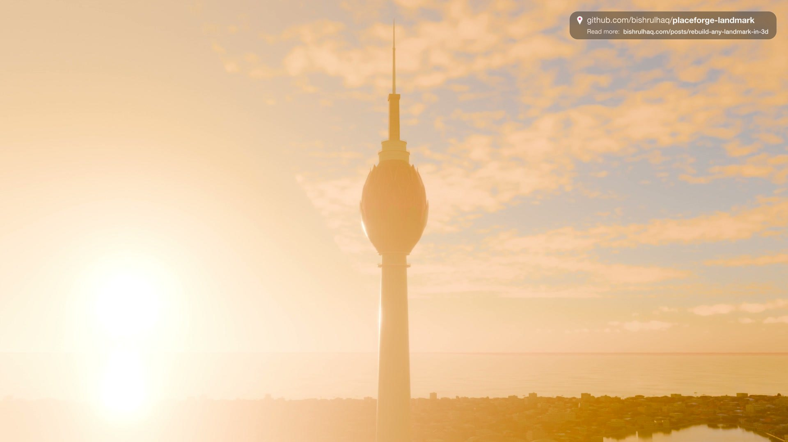</a><br><b>A film</b><br><sub>Any length: day, sunset, night, with traffic, people, trains, a helicopter</sub></td>
    <td align="center" width="33%"><a href="https://bishrulhaq.com/demos/lotus-tower-3d.html">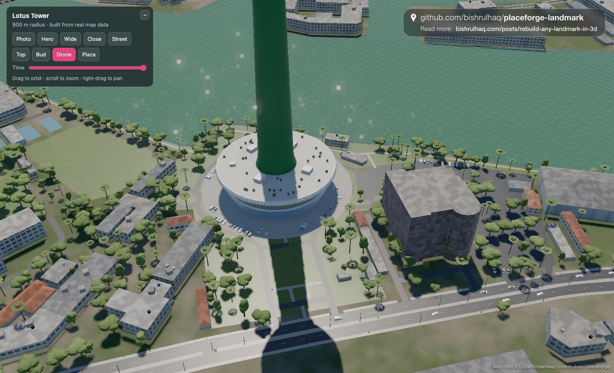</a><br><b>An interactive page</b><br><sub>One HTML file: orbit, views, a time-of-day slider, the same moving life</sub></td>
  </tr>
</table>
</div>

## The loop that makes it real

<p align="center">
  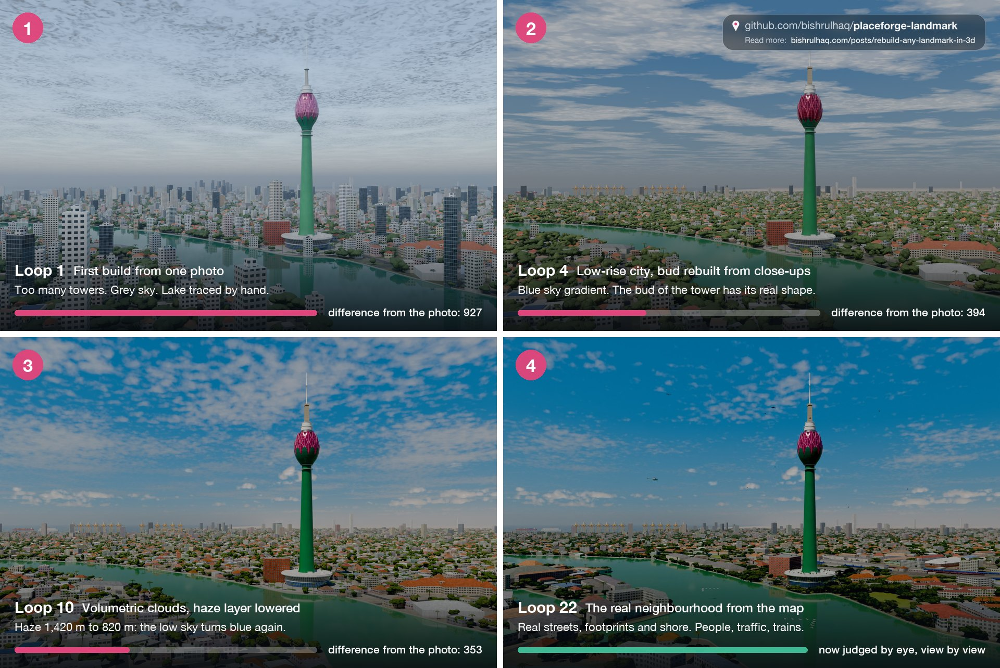
</p>

<p align="center"><sub>Loop 1 to loop 22 of the Lotus Tower. The bar is the difference from the reference photo: lower is better.</sub></p>

Each round: render, compare, fix the one to three largest gaps, render again. Wide view first, then the district,
the landmark, the street, a single detail. Each finished project adds its lessons to `references/lessons.md`, which
the skill reads before the next place.

## Gallery: the Lotus Tower

<div align="center">
<table>
  <tr>
    <td align="center" width="33%">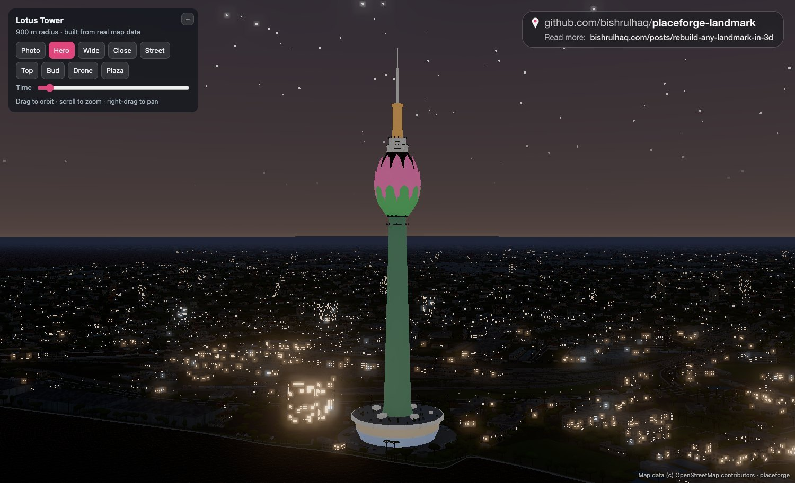<br><sub>The interactive page after dark</sub></td>
    <td align="center" width="33%">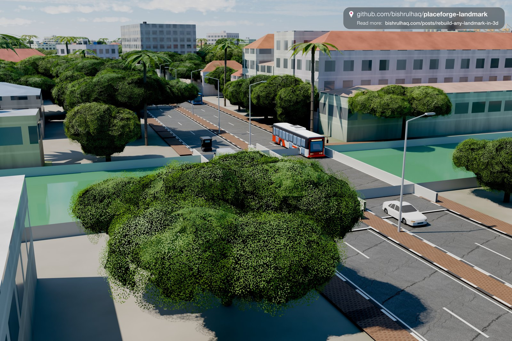<br><sub>Street level: traffic on the correct side</sub></td>
    <td align="center" width="33%">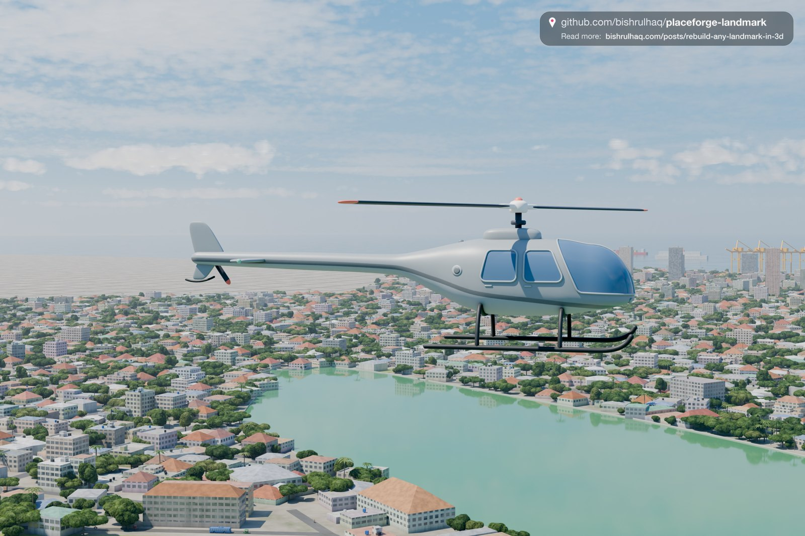<br><sub>A helicopter over Beira Lake</sub></td>
  </tr>
  <tr>
    <td align="center">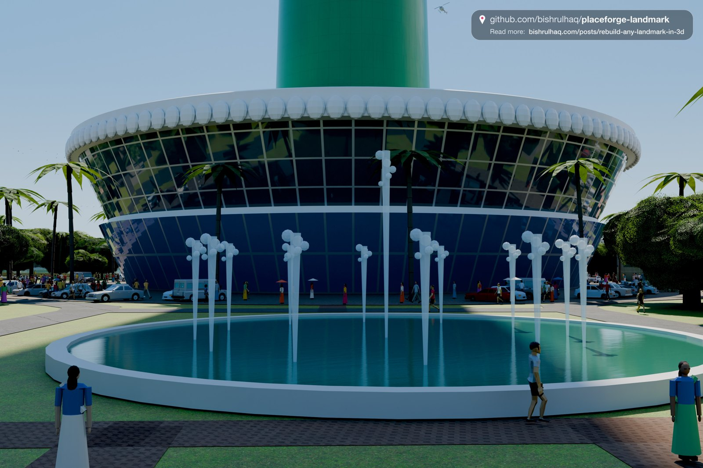<br><sub>The forecourt fountain</sub></td>
    <td align="center">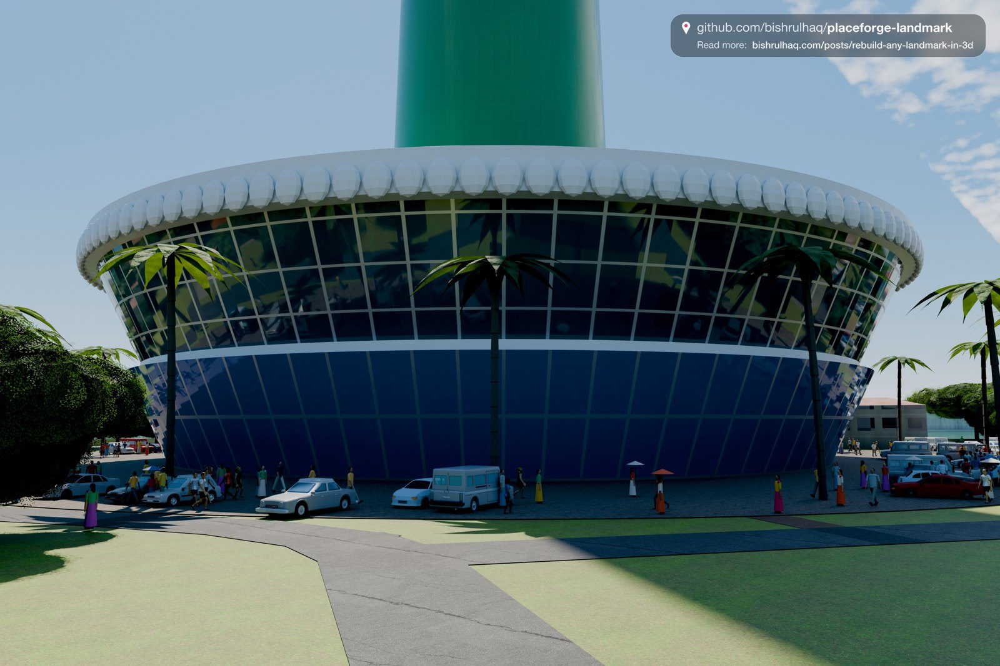<br><sub>The plaza, close up</sub></td>
    <td align="center">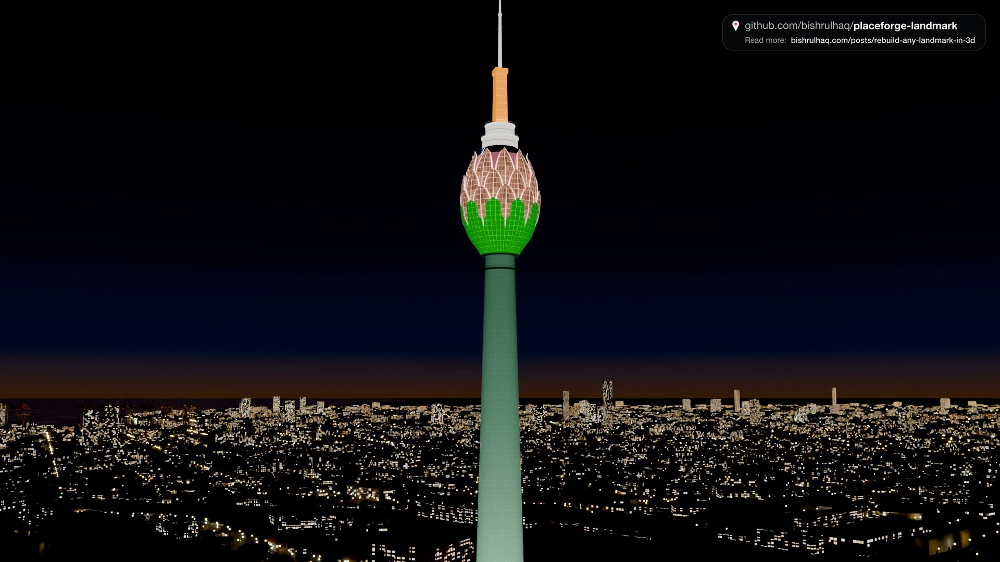<br><sub>Night: the tower's LED show</sub></td>
  </tr>
</table>
</div>

<p align="center">
  <a href="https://bishrulhaq.com/demos/lotus-tower-3d.html"><b>Open the live 3D demo</b></a><br>
  <sub>Orbit the tower, follow the bus, the train or the helicopter, drag the time from noon to night.<br>
  This demo is the hand-tuned viewer from the original Lotus Tower project; <code>pf web</code> builds a plainer page of the same kind for any place.</sub>
</p>

<p align="center">
  More stills, the full film and the run steps: <a href="examples/lotus-tower"><b>examples/lotus-tower</b></a>
</p>

## What you need

- [Claude Code](https://claude.com/claude-code)
- [Blender](https://www.blender.org/download/) 4.2 or newer (tested with 5.2), Python 3.9+, `pip install pillow`
- For films: `ffmpeg`. For viewer screenshots: Chrome and `pip install websocket-client`
- A place to render: your own GPU or CPU, **or** a rented GPU on [Vast.ai](https://vast.ai) (about $0.30 to $0.50
  an hour for an RTX 4090), **or** any Linux machine you can reach over SSH

## Install

```bash
git clone https://github.com/bishrulhaq/placeforge-landmark ~/.claude/skills/placeforge-landmark
```

Then ask Claude Code:

> Rebuild the Lotus Tower in Colombo from the photos in ~/Pictures/lotus. 900 m radius. I want a still, a 30 second
> film and a web page.

Claude asks for anything missing (photos, the pin, the radius, the outputs, where to render), then works through
the steps below.

## How it works

| Step | Command | What happens |
|---|---|---|
| Find the pin | `pf locate "Lotus Tower Colombo"` | Name, maps link or `lat,lon` to coordinates |
| Start a project | `pf init P --lat .. --lon .. --radius 900 --photos DIR` | `place.json`, `.env`, `landmark.py` |
| No photos? | `pf photos P` | Licensed photos near the pin and by name (Wikimedia Commons, Wikidata, Openverse), with credits. Opt-in `--browser` adds a web image search for references |
| Real map | `pf map P` | Streets, footprints, heights, water, coast, railways, parks, trees inside the radius |
| Read the photos | `pf refs P` | Contact sheet and a pixel grid on the target photo |
| Match the camera | `pf camera P --horizon .. --base-row .. --top-row ..` | Camera distance, height, lens and compass from one photo |
| Model the landmark | edit `P/landmark.py` | The one hand-made part, measured from the photos |
| Loop | `pf render`, `pf compare`, `pf log` | Render, compare, fix the worst gap, again |
| Film | `pf film plan / render / encode` | Shots in a JSON file; frames; MP4 with fades and music |
| Web | `pf web P` | Blender to Three.js: `P/web/index.html` |

The loop is recursive: wide view first, then the district, the landmark, the street, a single detail; each level
sends fixes back to the one scene description. And each finished project adds its lessons to
`references/lessons.md`, which the skill reads before the next place.

## Where renders run

Copy `.env.example` to `.env` in your project (`pf init` does it) and choose:

```ini
PF_COMPUTE=local      # this machine: Apple Metal, NVIDIA OptiX/CUDA, AMD HIP, Intel oneAPI, else the CPU
PF_COMPUTE=vast       # rent a GPU by the hour: add VAST_API_KEY and VAST_MAX_PRICE
PF_COMPUTE=ssh        # a machine you already have: add PF_SSH_HOST, PF_SSH_USER, PF_SSH_KEY
```

Your key never leaves `.env`. A rented machine is destroyed when the frames are down (`pf gpu P down`).

## Example

```bash
pf init lotus --name "Lotus Tower" --lat 6.92703 --lon 79.85828 --radius 900 --height 351.5
cp examples/lotus-tower/place.json examples/lotus-tower/landmark.py lotus/
pf map lotus && pf assets lotus
pf web lotus            # open lotus/web/index.html
```

## Honest limits

- The ground is flat; hilly sites need terrain, which is not built yet.
- Flyovers and tunnels are drawn at grade. Bridges over water get a deck.
- Beyond the detailed radius the city is generated, not mapped building by building.
- The landmark is modelled by Claude from your photos. Its quality depends on the photos (close-ups matter most)
  and on how many loops you let it run.
- Traffic follows lanes without junction rules; people only walk.
- The page `pf web` builds is plainer than the Lotus Tower live demo: no cloud layer, no mirror reflections on the
  water, no follow buttons yet.

## Credits and licences

- Code: MIT (see `LICENSE`).
- Map data: (c) [OpenStreetMap](https://www.openstreetmap.org/copyright) contributors, ODbL. Credit it wherever you
  show a result.
- Default models (cars, van, bus, people, train, helicopter): Quaternius (via Poly Pizza) and Grab3D, CC0. Ground textures: Poly Haven, CC0. The list and
  every licence: `assets.default.json`.
- Your reference photos stay yours (or their photographers'). They are references, never published by this tool.
- Photos found by `pf photos`: the licensed ones come with author and licence in `refs/CREDITS.md`. The opt-in web
  image search (`--browser`) reads a public results page with [CloakBrowser](https://github.com/CloakHQ/CloakBrowser)
  (installed on first use, version 0.6.3, free build; your own Chrome if that fails): read-only, without login, a
  few searches at most, and it stops at any verification wall. What it finds has no known licence and is for
  reference only.
