# Example: Lotus Tower, Colombo

The place this skill was born from: the 351.5 m Lotus Tower (Nelum Kuluna) on Beira Lake, rebuilt from a handful of
reference photos, a map pin and a 900 m radius.

**Live 3D demo:** [bishrulhaq.com/demos/lotus-tower-3d.html](https://bishrulhaq.com/demos/lotus-tower-3d.html)  ·  **Article:** [bishrulhaq.com/posts/rebuild-any-landmark-in-3d](https://bishrulhaq.com/posts/rebuild-any-landmark-in-3d)

[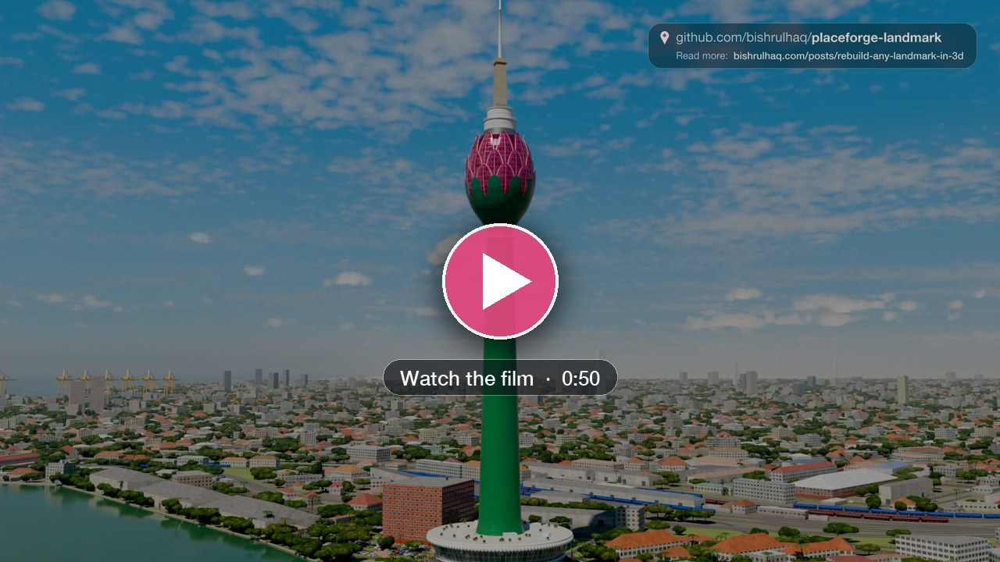](media/lotus_tower_film.mp4)

**The film** (50 s: a one-second opening card with the map, then day, sunset and night): [`media/lotus_tower_film.mp4`](media/lotus_tower_film.mp4)

## Stills (Blender Cycles)

| The reference photo's view | Drone |
|---|---|
| 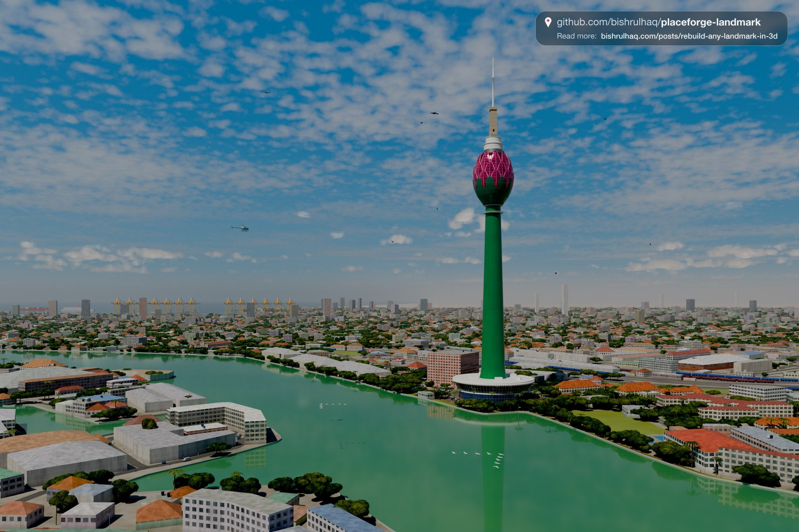 | 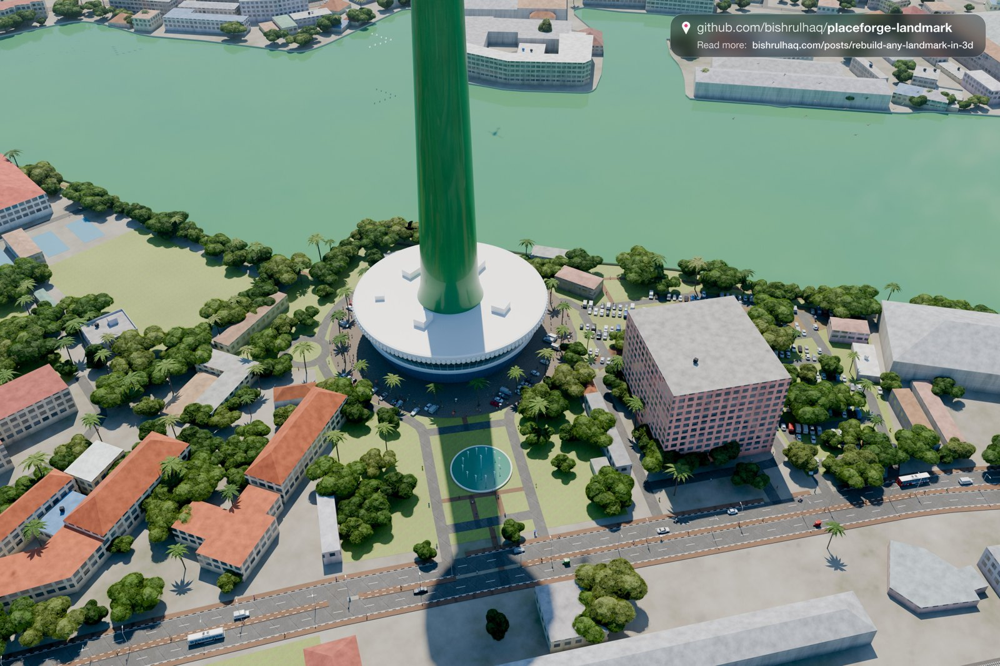 |

| Plaza | Street |
|---|---|
| 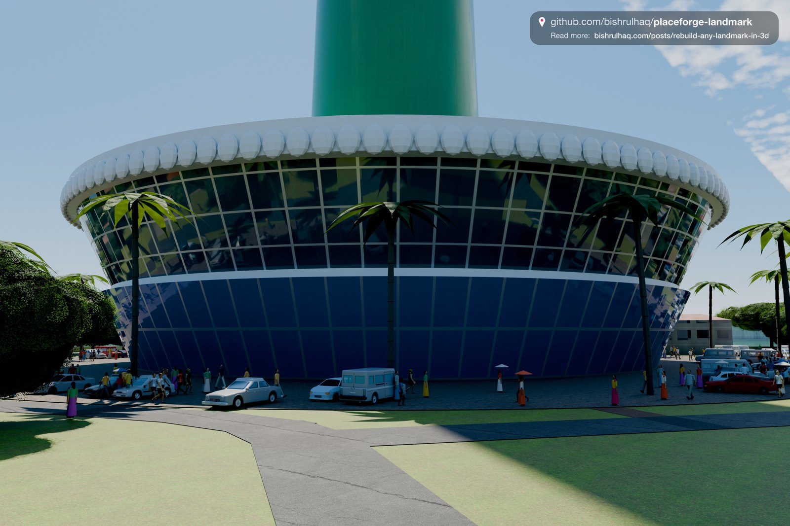 | 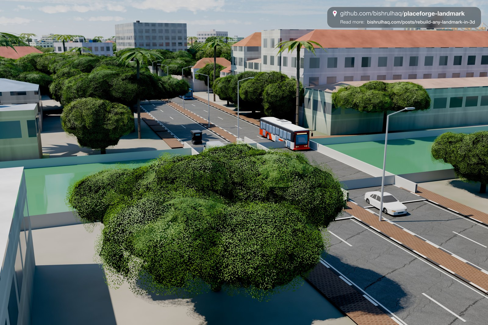 |

| Helicopter over the lake | Fountain |
|---|---|
| 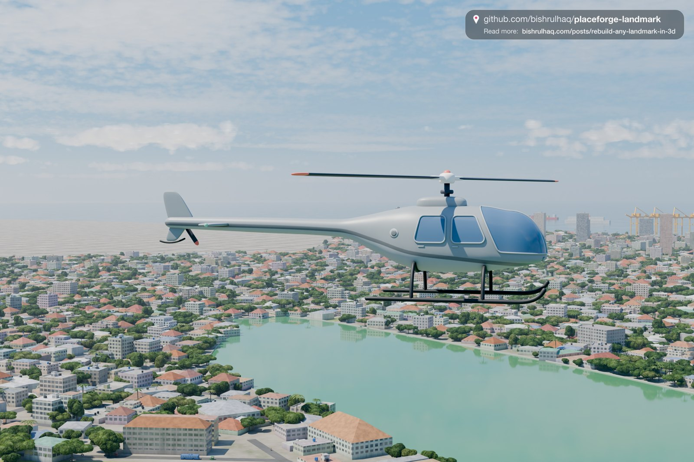 | 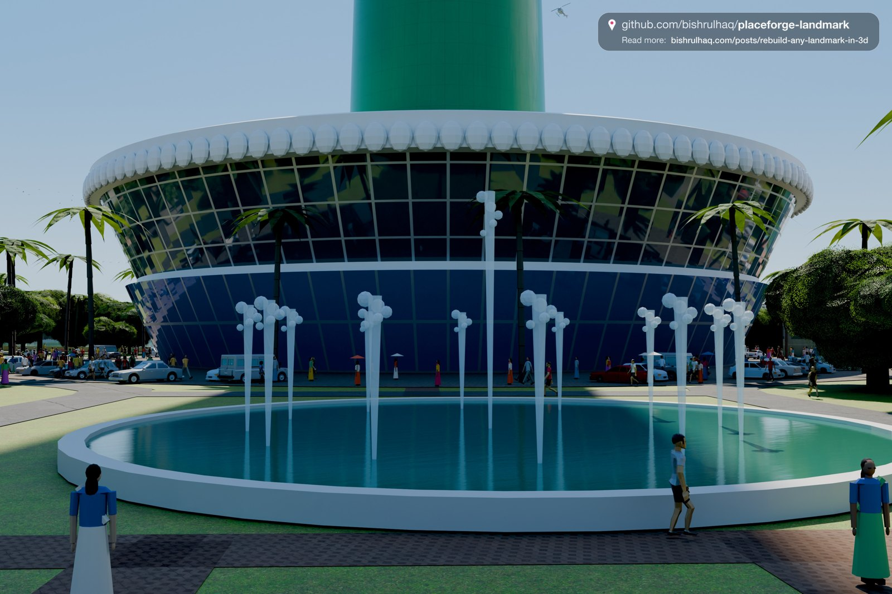 |

| Sunset (film frame) | Night (film frame) |
|---|---|
| 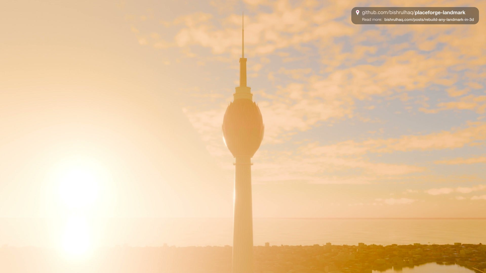 | 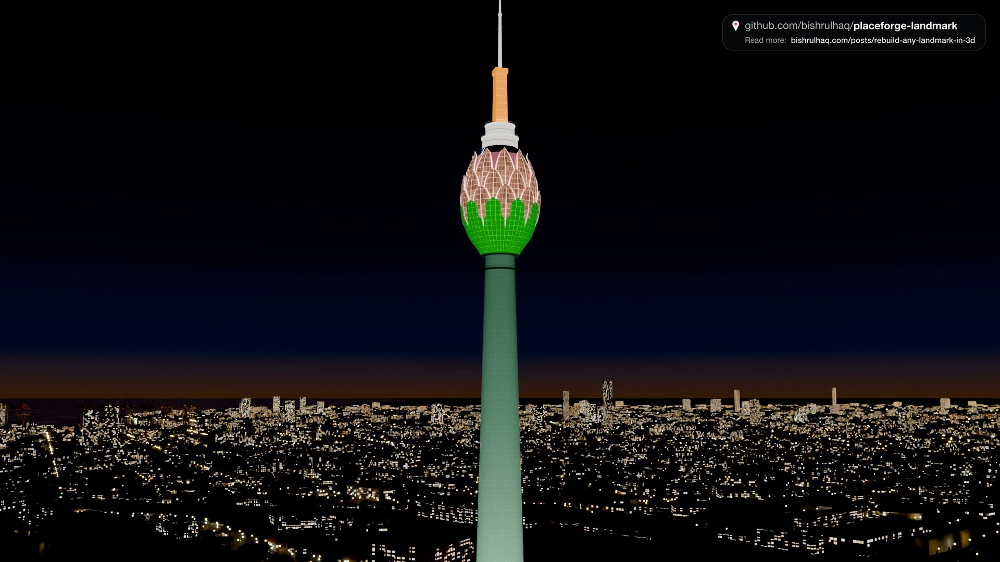 |

## The interactive page (Three.js)

Built from the same scene description by `pf web`: orbit controls, view buttons, a time-of-day slider, traffic,
people, trains and the helicopter moving.

The screenshots below are the page `pf web` builds. The [live demo](https://bishrulhaq.com/demos/lotus-tower-3d.html) is the hand-tuned viewer from the
original project, which has more in it (a cloud layer, reflections on the lake, buttons to follow the bus, the train
and the helicopter).

| Day | Night |
|---|---|
| 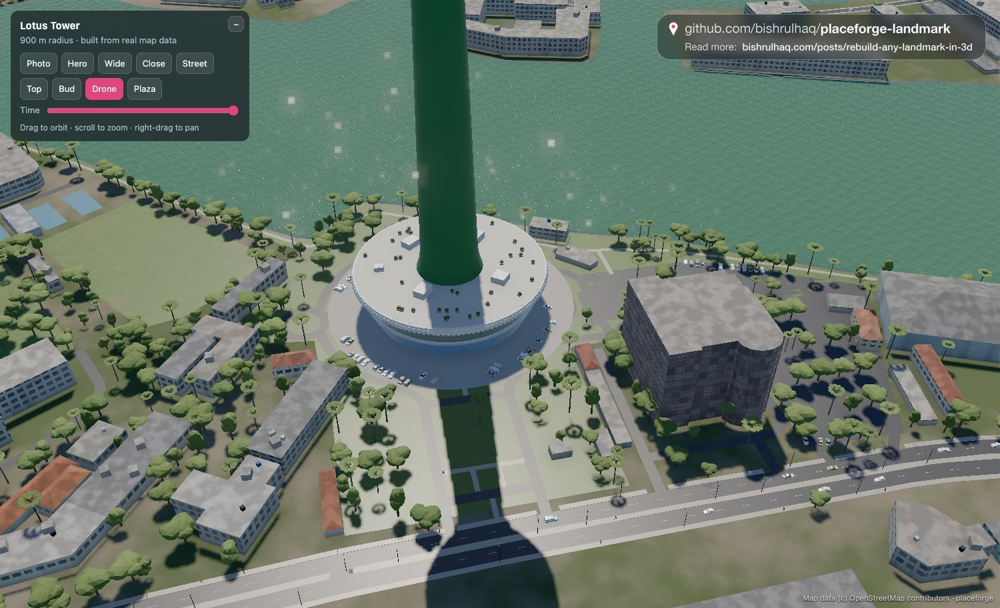 | 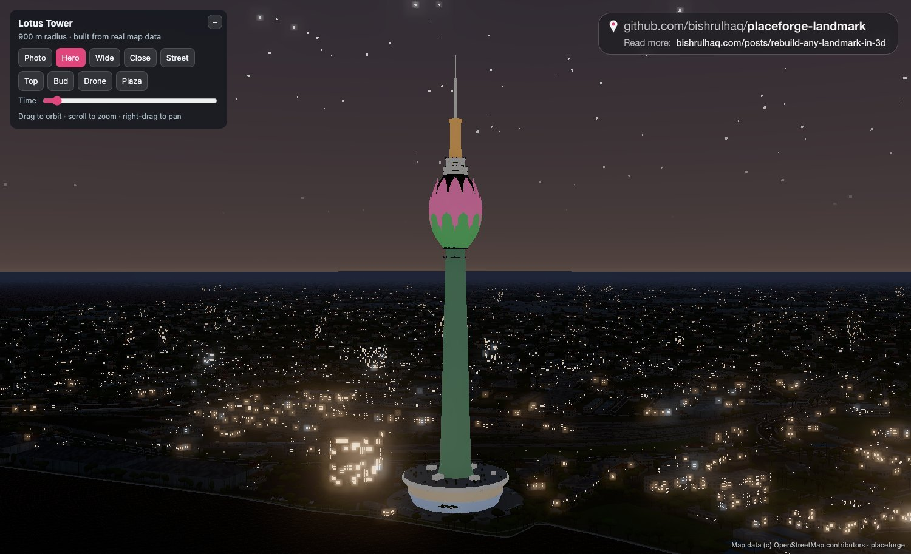 |

## What is in this folder

- `place.json`: the matched camera (28 mm, 644 m from the tower, 100 m up, looking bearing 355), Colombo's region
  settings (left-hand traffic, rooftop water tanks, palms, monsoon weathering, the lake's green), the compare
  regions and the extra views.
- `landmark.py`: the whole tower, modelled from close-up photos: podium, shaft, calyx, three tiers of ten petals,
  cap, mast, antenna, and its night lighting.

## Run it

```bash
pf init lotus --name "Lotus Tower" --lat 6.92703 --lon 79.85828 --radius 900 --height 351.5
cp examples/lotus-tower/place.json examples/lotus-tower/landmark.py lotus/
pf photos lotus --query "Lotus Tower Colombo"   # or put your own photos in lotus/refs/
pf map lotus && pf assets lotus
pf build lotus                                  # BUILD OK
pf web lotus && pf shot lotus photo             # the Three.js page
pf render lotus --name loop01 --view photo,bud,drone
pf compare lotus loop01_photo
```

## How it got here

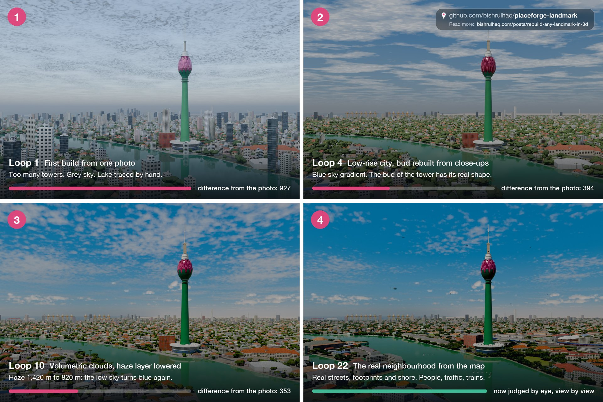

From the first render to the last. The bar is the difference from the reference photo (lower is better). From loop 11 the foreground follows the real map, so the later loops were judged by eye.

The stills and the film above were rendered during the project this skill was extracted from, on rented RTX 4090s.
The numbers from its loop log:

- Ten loops took the difference from the reference photo from 927 to 353 (sum of region colour differences).
  The three biggest drops: making the near city low-rise, rebuilding the bud from close-ups, and lowering the haze
  layer from 1,420 m to 820 m.
- Twelve more loops added the real neighbourhood from OpenStreetMap, people, vehicles, trains and downloaded models.
- Ten preview loops and a 4K final cost well under $1. A 30 s film at 1080p cost $1.64 on three machines.

What each loop changed is in [`references/lessons.md`](../../references/lessons.md).

**Read more:** the full write-up of this build is at [bishrulhaq.com/posts/rebuild-any-landmark-in-3d](https://bishrulhaq.com/posts/rebuild-any-landmark-in-3d).

## Credits

- Map data (c) [OpenStreetMap](https://www.openstreetmap.org/copyright) contributors, ODbL.
- Music in the film: "Titan" by Scott Buckley, released under CC BY 4.0. www.scottbuckley.com.au
- Vehicles, people, trains, helicopter: Quaternius (via Poly Pizza) and Grab3D, CC0. Ground textures: Poly Haven, CC0.
- Birds that appear in some stills, CC BY 3.0 via Poly Pizza: "Hawk Lp Rigged" by Sherkiz
  (https://poly.pizza/m/RkN6MEbP6g), "Crow" by Poly by Google (https://poly.pizza/m/1MIvWQ5Q3R9),
  "American White Pelican" by Poly by Google (https://poly.pizza/m/2J2HY1oq8l2).
- Reference photos are not included: they belong to their photographers.
