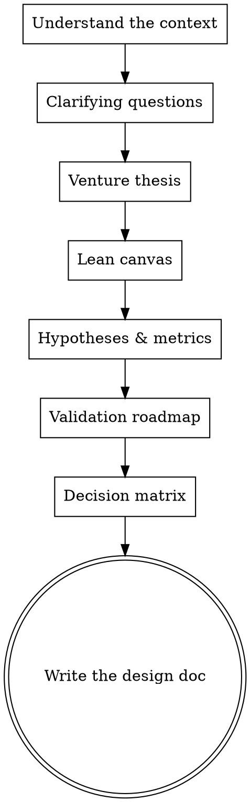

# Business Design Workshop

An interactive workshop that turns a business idea into a structured, testable business design.
The result is a design doc with a venture thesis, lean canvas, hypotheses, validation roadmap and
decision matrix.

Be analytical, direct and pragmatic.

## Project context

$ARGUMENTS

## Workflow — 5 sections

Take the user through **one section at a time**. Present each section, wait for approval, then
continue. Use `AskUserQuestion` for structured decisions — **one question per message**.



---

### Step 0: Understand the context

Before asking anything, read what already exists:
- `docs/plans/` — existing design docs, due diligence results
- `CLAUDE.md` — project conventions
- Recent git commits — the current state

Then ask **clarifying questions** (one per message, multiple choice preferred):

1. **Vision** — a one-off test or a long-term business?
2. **Revenue model** — how should this make money? (or: still unclear?)
3. **Target output** — what should exist at the end?
4. **Audience for the doc** — who is this document for? (internal, investors, sponsors)

Adapt depth and tone to the answers. "Revenue still unclear" means no forced revenue
assumptions. "For investors" means a persuasive tone backed by market data.

---

### Section 1: Venture thesis

Based on the answers, formulate:

- **One-liner:** a single sentence describing the whole venture
- **Core thesis:** 2-3 sentences describing the market problem, the solution and the connection
  between the audiences
- **Unfair advantage:** 2-4 bullet points — what does this venture have that others do not?

**Strategy kernel check** (Good Strategy / Bad Strategy, Rumelt): the thesis must contain three
parts — (1) a **diagnosis** (what is the actual bottleneck?), (2) a **guiding policy** (an
overall approach that deliberately rules a lot OUT), and (3) **coherent actions**. Warning signs
of bad strategy: a fog of buzzwords, goals instead of a plan ("20% growth" is not a strategy),
and wish lists instead of focus on the bottleneck.

**Present it and wait for approval.** Only then continue.

---

### Section 2: Lean canvas

Build a lean canvas table with these fields:

| Field | Description |
|---|---|
| **Problem** | What is the core problem? Why does it exist? |
| **Audiences** | Primary and secondary (where applicable, e.g. users plus B2B partners) |
| **Value proposition** | For each audience — what is the concrete value? |
| **Solution** | How is the problem solved? Concretely, not abstractly. |
| **Channels** | How do we reach the audiences? |
| **Revenue streams** | How does this make money? (may be "TBD after validation") |
| **Cost structure** | What are the main costs? |
| **Key metrics** | Which numbers show whether it works? |
| **Unfair advantage** | Why can nobody simply copy this? Check it against the 7 Powers (Helmer): real power needs a benefit AND a barrier. "Faster, better, cheaper" is not a power. |

**Important:** use a lean canvas rather than a classic business model canvas — it fits early
stage better. Fields may say "TBD" where things are honestly still unclear.

**Present it and wait for approval.**

---

### Section 3: Hypotheses and experiment metrics

Formulate **2-5 testable hypotheses** as a table:

| # | Hypothesis | Pass criterion | Fail criterion | Measurement method |
|---|---|---|---|---|
| H1 | A clear, falsifiable statement | A concrete threshold | A concrete threshold | Exactly how is this measured? |

**Rules for good hypotheses:**
- Every hypothesis must be **falsifiable** — with a clear pass/fail threshold
- The measurement method must be **concrete** (a database query, a survey question, an analytics
  event)
- Distinguish **pre-launch hypotheses** (testable via a landing page or ads) from **post-launch
  hypotheses** (only testable after the product or event exists)
- Sort them by sequence: what can be tested first?

**Present it and wait for approval.**

---

### Section 4: Validation roadmap

Build a **sprint-based roadmap** with three sprints. The goal: at most eight weeks until real
customers pay.

**Enforced order within every sprint:**

```
Desk research → secondary research → experiments
```

- **Desk research** means evaluating data that already exists (your own data, studies,
  competitor analysis). No new spend.
- **Secondary research** means new data without a product (surveys, interviews, experts). Small
  budget.
- **Experiments** means real tests with real people (ads, landing pages, a pilot). Larger budget.

This order prevents money being spent before existing knowledge has been evaluated.

#### Sprint 1 — "research and concept" (typically 1-2 weeks)
- **Goal:** validate the problem, the pricing and the model — BEFORE anything is built
- Desk research: what do we already know? (previous work, studies, market reports)
- Secondary research: surveys (pricing, Van Westendorp), interviews (problem validation, max
  five)
- **No experiments in sprint 1.** Gather knowledge only.
- Gate: **discovery gate** — are the base assumptions validated?

#### Sprint 2 — "prototype and demand" (typically 2-3 weeks)
- **Goal:** prove demand with a landing page and ads
- Desk research: consolidate sprint 1 results, adjust the messaging
- Secondary research: validate the supply side (partners, LOIs)
- Experiments: landing page live, ad test (cold traffic, stealth recommended), A/B tests
- Gate: **go/kill gate 1** — thresholds for signups, CAC, conversion

#### Conditional: legal and compliance gate (regulated industries only)
If the venture operates in a regulated area (health, finance, insurance), put a legal gate BEFORE
sprint 3. Start it in parallel with sprint 2 — it has a long lead time. Typical items: a legal
opinion, insurance, terms and conditions, a data protection impact assessment. **No pilot without
a legal basis.**

For unregulated ventures (SaaS, marketplace, consumer), standard terms are enough and no separate
gate is needed.

#### Sprint 3 — "pilot" (typically 2-3 weeks; this is where most of the money goes)
- **Goal:** real customers, real money, real retention
- Desk research: evaluate the prototype data (funnel, CAC, best creatives)
- Secondary research: NPS survey, reasons for churn
- Experiments: soft launch from the waitlist, paid transactions, measure retention
- Gate: **go/kill gate 2** — revenue, conversion, NPS, retention

#### After the three sprints: the scale decision
Go means expansion, new markets, B2B. Kill means a post-mortem and documented learnings.

**Budget defaults:** sprint 1 minimal, sprint 2 moderate (ads plus any legal work), sprint 3 the
most. Adjust sprint length and budget to the complexity of the venture.

**Present it and wait for approval.** Adapt it if the user rejects stealth or wants different
sprint lengths.

---

### Section 5: Decision matrix

Build a decision matrix covering **all realistic scenarios**:

| Scenario | Hypothesis A | Hypothesis B | Decision |
|---|---|---|---|
| **Best case** | Pass | Pass | **Go.** Next phase. |
| **Partial success A** | Pass | Fail | **Go with reservations.** What do we adjust? |
| **Partial success B** | Fail | Pass | **Pivot.** Pivot what exactly? |
| **Wrong audience** | Pass (wrong audience) | Either | **Pivot the audience.** |
| **Worst case** | Fail | Fail | **Kill or fundamental pivot.** Post-mortem. |

Add **kill criteria** — hard stops that prevent money being wasted:
- A concrete threshold plus a timeframe → stop
- An early warning signal → rework the messaging immediately

**Present it and wait for approval.**

---

## After the workshop

### Save the design doc

Combine all five sections into one document and save it as:

```
docs/plans/YYYY-MM-DD-<project-name>-business-design.md
```

Format:
```markdown
# Business Design: [project name]

**Date:** YYYY-MM-DD
**Status:** Approved
**Venture:** [venture name]
**Audience:** [who is this doc for?]

---

## 1. Venture thesis
[...]

## 2. Lean canvas
[...]

## 3. Hypotheses and experiment metrics
[...]

## 4. Validation roadmap
[...]

## 5. Decision matrix
[...]

---

## Validation tool
[reference to the landing page, MVP or experiment that implements phase 1]
```

### Commit

```bash
git add docs/plans/YYYY-MM-DD-*-business-design.md
git commit -m "Add [project name] business design document"
```

### Next step

Ask the user:
> "The business design is ready. How do you want to continue?"

Options:
- **Build the validation tool** → invoke `superpowers:brainstorming` for the landing page or MVP
  design
- **Go deeper on due diligence** → invoke the `venture-dd` skill
- **Done for now** → no further action

---

## Key rules

1. **One section at a time** — never jump ahead
2. **Get each section approved individually** — not all at once
3. **One question per message** — multiple choice preferred
4. **Stay honest** — "TBD" beats invented assumptions
5. **Hypotheses must be falsifiable** — no soft wishful statements
6. **Kill criteria are mandatory** — every business design needs clear stops
7. **Lean canvas rather than BMC** — it fits pre-validation better
8. **Recommend stealth** — your own network introduces bias; cold traffic is the real signal
9. **Read the existing docs** — due diligence results, existing plans, CLAUDE.md
